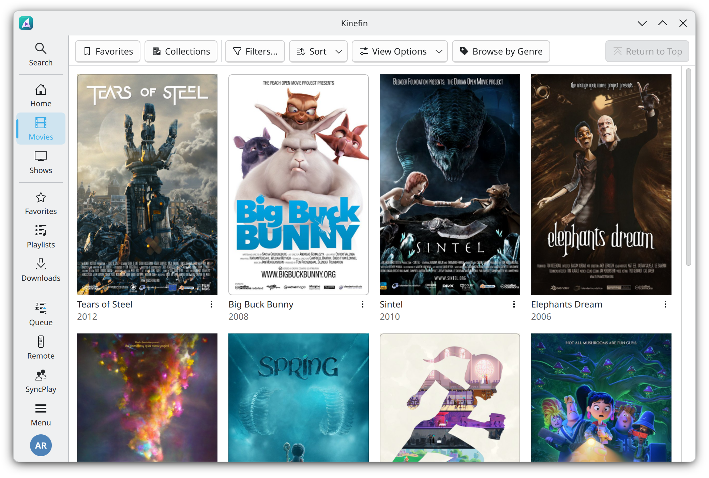

# Kinefin

A native KDE Plasma 6 client for Jellyfin servers: Kirigami interface, its own REST client and a libmpv playback engine, without WebEngine. It browses movies and TV series (Home, library tabs with filters, Favorites, search, details, a play queue), plays them with mpv or on a DLNA TV or player, downloads them for offline playback, can control the server's remote sessions and searches from KRunner; music and audiobooks are not built yet. It builds and runs as a Flatpak, but acceptance against a real Jellyfin server on a Plasma desktop is still pending for most v1 features; this is **not yet a release-ready client**.

## Screenshots

<picture>
  <source media="(prefers-color-scheme: dark)" srcset="docs/images/dark/home.png">
  
</picture>

<picture>
  <source media="(prefers-color-scheme: dark)" srcset="docs/images/dark/library.png">
  
</picture>

<picture>
  <source media="(prefers-color-scheme: dark)" srcset="docs/images/dark/series.png">
  
</picture>

<picture>
  <source media="(prefers-color-scheme: dark)" srcset="docs/images/dark/player.png">
  
</picture>

The pictures show a library of the open films of the Blender Foundation and Blender Studio, with their posters and frames, rendered by `build/screenshots.sh` in the Breeze style of Plasma, in the light and the dark color scheme (the page shows the one your browser asks for). The artwork is licensed CC BY; the film in the player is *Tears of Steel* (CC BY 3.0, Blender Foundation | mango.blender.org).

<details>
<summary>Credits of the artwork</summary>

| Film | File on Wikimedia Commons | License |
| --- | --- | --- |
| Elephants Dream | [ElephantsDreamPoster.jpg](https://commons.wikimedia.org/wiki/File:ElephantsDreamPoster.jpg) | [CC BY 4.0](https://creativecommons.org/licenses/by/4.0/) |
| Big Buck Bunny | [Big buck bunny poster big.jpg](https://commons.wikimedia.org/wiki/File:Big_buck_bunny_poster_big.jpg) | [CC BY 3.0](https://creativecommons.org/licenses/by/3.0/) |
| Sintel | [Sintel poster.jpg](https://commons.wikimedia.org/wiki/File:Sintel_poster.jpg) | [CC BY 3.0](https://creativecommons.org/licenses/by/3.0/) |
| Tears of Steel (poster) | [Tos-poster.png](https://commons.wikimedia.org/wiki/File:Tos-poster.png) | [CC BY 3.0](https://creativecommons.org/licenses/by/3.0/) |
| Tears of Steel (frame) | [Tears of Steel frame 08 4a.jpg](https://commons.wikimedia.org/wiki/File:Tears_of_Steel_frame_08_4a.jpg) | [CC BY 3.0](https://creativecommons.org/licenses/by/3.0/) |
| Tears of Steel (frame) | [Tears of Steel frame 01 2a.jpg](https://commons.wikimedia.org/wiki/File:Tears_of_Steel_frame_01_2a.jpg) | [CC BY 3.0](https://creativecommons.org/licenses/by/3.0/) |
| Tears of Steel (frame of the player) | [Tears of Steel frame 09 1a.jpg](https://commons.wikimedia.org/wiki/File:Tears_of_Steel_frame_09_1a.jpg) | [CC BY 3.0](https://creativecommons.org/licenses/by/3.0/) |
| Cosmos Laundromat | [CosmosLaundromatPoster.jpg](https://commons.wikimedia.org/wiki/File:CosmosLaundromatPoster.jpg) | [CC BY 4.0](https://creativecommons.org/licenses/by/4.0/) |
| Spring | [Spring2019AlphaPosterBlender.jpg](https://commons.wikimedia.org/wiki/File:Spring2019AlphaPosterBlender.jpg) | [CC BY 4.0](https://creativecommons.org/licenses/by/4.0/) |
| Coffee Run | [Coffee Run-movie poster.png](https://commons.wikimedia.org/wiki/File:Coffee_Run-movie_poster.png) | [CC BY 4.0](https://creativecommons.org/licenses/by/4.0/) |
| Sprite Fright | [Sprite Fright-movie poster.jpg](https://commons.wikimedia.org/wiki/File:Sprite_Fright-movie_poster.jpg) | [CC BY 4.0](https://creativecommons.org/licenses/by/4.0/) |
| Charge | [Charge-movie poster.jpg](https://commons.wikimedia.org/wiki/File:Charge-movie_poster.jpg) | [CC BY 4.0](https://creativecommons.org/licenses/by/4.0/) |

The posters and frames are scaled or cropped copies of the files above; the screenshots in `docs/images` are derived from them and carry the same licenses.

</details>

## Building

Everything that needs Qt, KF6 or ECM runs in a Podman container; see [CONTRIBUTING.md](CONTRIBUTING.md).

```sh
build/build-env.sh build/check.sh
```

## KRunner

While Kinefin is open and signed in, KRunner can find movies, series, episodes and collections on the server; the plugin is off by default, and the [user guide](docs/user-guide.md#search-from-krunner) explains how to turn it on and what it sends.

## Documentation

The [user guide](docs/user-guide.md) explains how to use Kinefin, the [settings reference](docs/settings.md) lists every setting with its default, and the [architecture overview](docs/architecture.md) is where contributors start.

## Release preparation

The first-release tooling and remaining acceptance requirements are documented in the [first-release checklist](build/release/FIRST_RELEASE.md); see also [release tooling](build/release/README.md). A passing offline preflight is not permission to publish a release.

```sh
python3 -I build/release/preflight.py
```

## License

GPL-3.0-or-later, see [LICENSE](LICENSE). Jellyfin is a trademark of the Jellyfin project; Kinefin is an independent, clean-room client.
