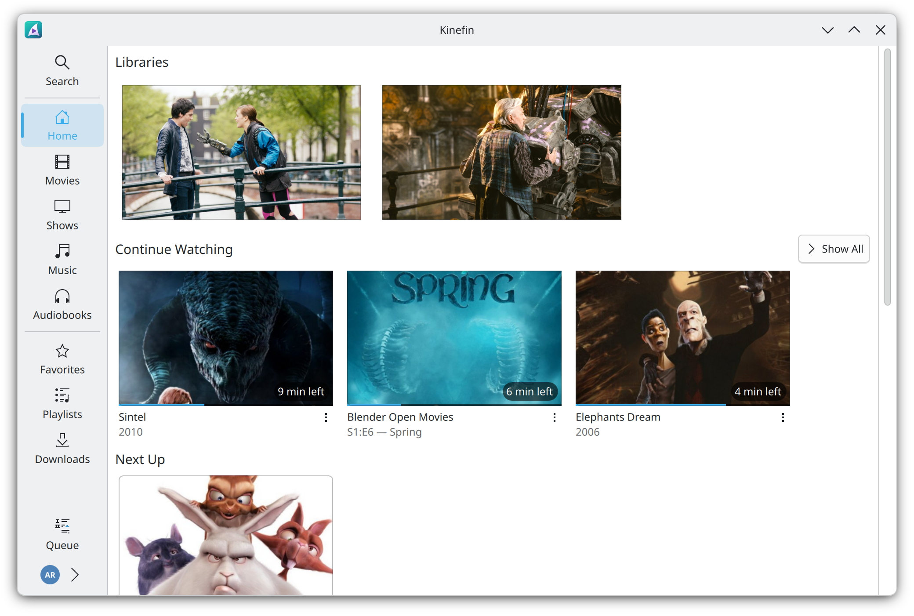
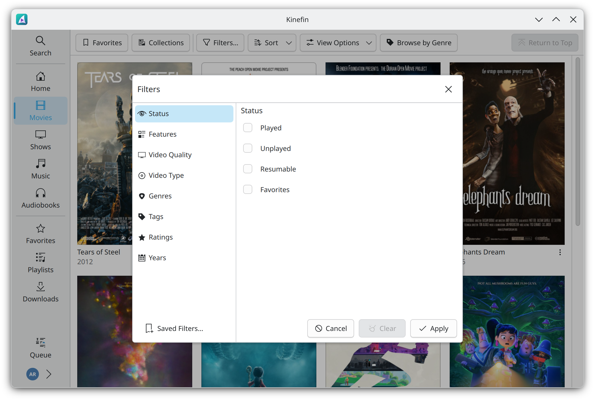
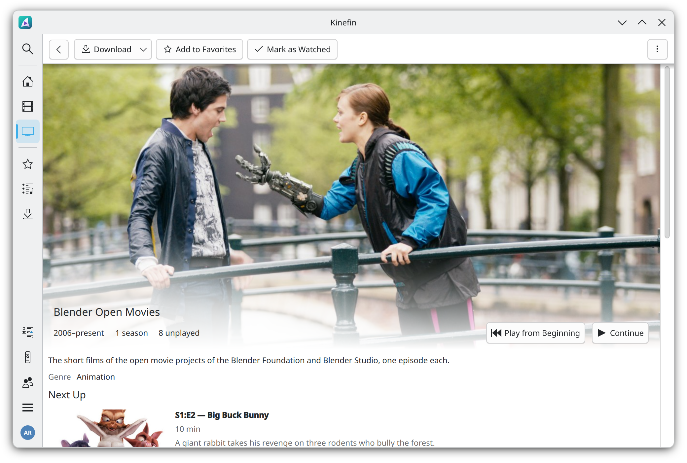
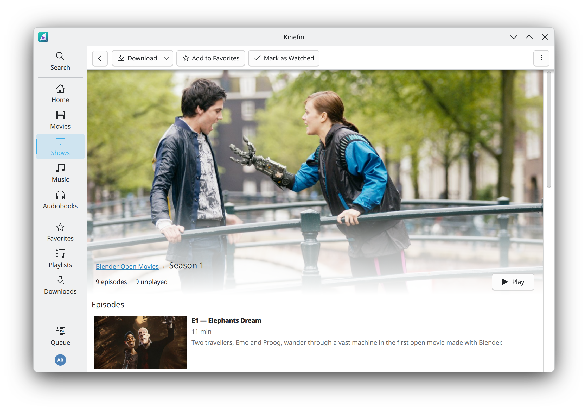
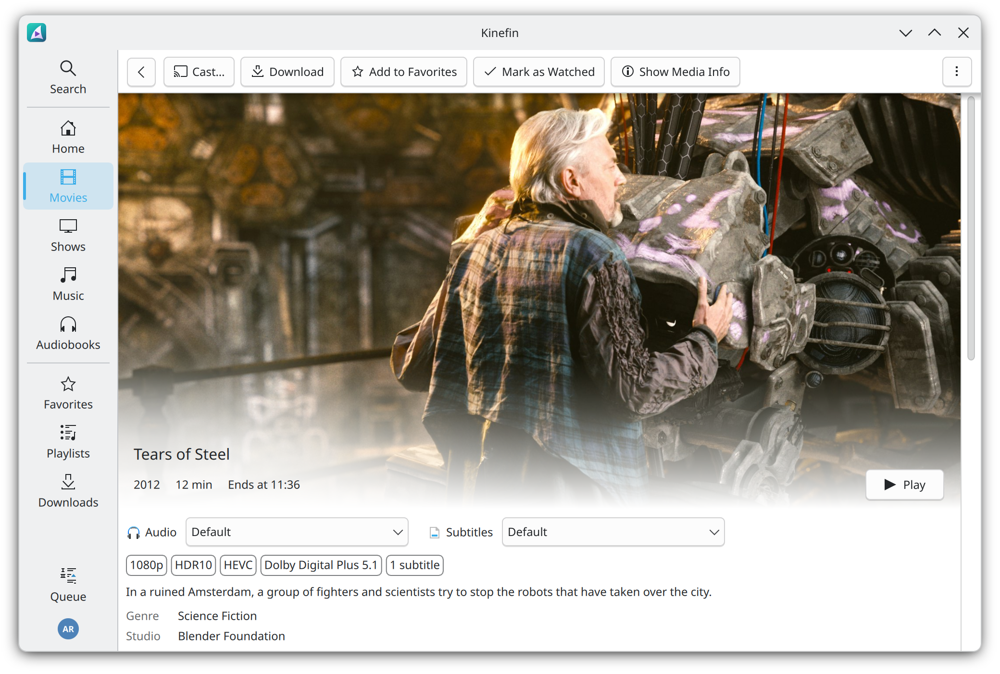
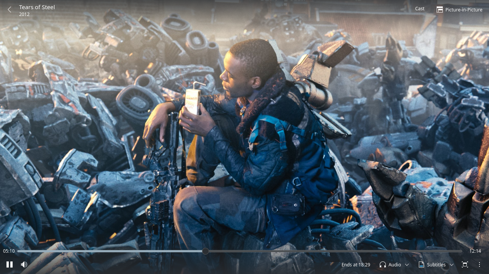

# Kinefin

<p align="center">
  
</p>

<p align="center">
  <b>Native KDE Plasma client for Jellyfin servers.</b><br>
  Browse your movies and shows, play them with mpv, cast them to a TV and keep them for offline viewing, in a Kirigami interface that follows your Plasma theme.
</p>

<p align="center">
  <a href="https://github.com/the-beper/Kinefin/releases"></a>
  <a href="https://github.com/the-beper/Kinefin/actions/workflows/ci.yml"></a>
  
</p>

<picture>
  <source media="(prefers-color-scheme: dark)" srcset="docs/images/dark/home.png">
  
</picture>

## Why

Jellyfin Desktop, the official desktop client, shows the Jellyfin web interface in a Qt WebEngine window and plays the video with mpv. The app looks and behaves like the website, not like the rest of a Plasma desktop.

Kinefin is written for Plasma instead. The interface is Kirigami and follows the KDE HIG and your color scheme, it talks to the server through its own client for the Jellyfin REST API, and libmpv plays the video. No browser engine is loaded. Where a client setting maps to mpv, Kinefin keeps Jellyfin Desktop's name, default and values, so the playback behaves the same.

## What it does

### Browse

- Home with Continue Watching, Next Up, Favorites and Recently Added; Movies and Shows pages with filters, saved filter sets, sort orders and grid or list views.
- Details pages for movies, series, seasons and episodes, with the audio and subtitle track chosen before you play. Search, Favorites, video playlists and a play queue.
- Several servers, and several users per server. Sign in with a password or Quick Connect; the access token is kept in the system keyring through the Secret portal, never in plain text.

### Play

- Direct play or server transcoding, chapters, Skip Intro and the other media segments, Up Next, and a quality cap that also lowers itself on a slow connection.
- Audio and subtitle tracks, a second subtitle line, subtitle files of your own, and subtitle search through the server's OpenSubtitles plugin.
- A mini player and a picture-in-picture window while you browse. Clips and GIFs, debanding and your own GLSL shaders.
- HDR video shown as HDR on HDR screens (KWin on Plasma 6.4 or later), in the full player.
- Audio passthrough, hardware decoding and subtitle styling with Jellyfin Desktop's settings, and your own `mpv.conf` on top.

### On other screens and with other people

- Cast to DLNA renderers and Google Cast devices.
- SyncPlay groups, control of the server's other sessions, and control of Kinefin from other Jellyfin clients.

### Offline

- Downloads of the original files, one item at a time, a whole season at once or by a rule per series. Offline playback, with the watched state sent to the server when you are back online, and export to a folder.

### Plasma integration

- MPRIS (media keys and the Plasma media controls), KRunner search, and the screen kept on while a video plays.
- Keyboard shortcuts throughout, and an experimental gamepad mode.
- English and Italian interface.

### Not included

- Music and audiobooks: their libraries show on Home but stay disabled for now, and their sidebar entries say they are coming soon. Both are planned (see the [TODO](TODO.md)).
- Server administration: **Admin Dashboard** opens the server's web interface in your browser.

## Gallery

<table>
  <tr>
    <td><picture><source media="(prefers-color-scheme: dark)" srcset="docs/images/dark/library.png"></picture></td>
    <td><picture><source media="(prefers-color-scheme: dark)" srcset="docs/images/dark/filters.png"></picture></td>
  </tr>
  <tr>
    <td><picture><source media="(prefers-color-scheme: dark)" srcset="docs/images/dark/series.png"></picture></td>
    <td><picture><source media="(prefers-color-scheme: dark)" srcset="docs/images/dark/season.png"></picture></td>
  </tr>
  <tr>
    <td><picture><source media="(prefers-color-scheme: dark)" srcset="docs/images/dark/details.png"></picture></td>
    <td><picture><source media="(prefers-color-scheme: dark)" srcset="docs/images/dark/player.png"></picture></td>
  </tr>
</table>

The screenshots follow your browser's light or dark mode. They show the open films of the Blender Foundation and Blender Studio (CC BY), rendered by `build/screenshots.sh` in the Breeze style; [THIRD_PARTY.md](THIRD_PARTY.md#documentation-artwork) credits the artwork.

## Install

Kinefin is packaged only as a Flatpak, for Linux on x86-64 with Plasma on Wayland.

```sh
flatpak install https://the-beper.github.io/Kinefin/kinefin.flatpakref
```

A signed bundle is also available. The [user guide](docs/user-guide.md#install-and-update) covers it, updating, uninstalling and the signing key.

## Getting started

1. Start Kinefin, enter your server's address on the **Servers** page and press **Connect**.
2. Sign in with your password, or choose Quick Connect and confirm the code from a Jellyfin client that is already signed in.
3. Pick something on **Home**, **Movies** or **Shows** and press **Play**.

Ctrl+, opens the settings, and Ctrl+Shift+/ lists the keyboard shortcuts.

## Documentation

| Page                                     | For                                                                                                                                         |
| ---------------------------------------- | ------------------------------------------------------------------------------------------------------------------------------------------- |
| [User guide](docs/user-guide.md)         | Install and update, signing in, browsing, playback, downloads, casting, KRunner, keyboard and gamepad, troubleshooting, where the files are |
| [Settings reference](docs/settings.md)   | Every setting with its key, default and values                                                                                              |
| [Architecture](docs/architecture.md)     | The code map, the invariants and the decisions, for contributors                                                                            |
| [Contributing](CONTRIBUTING.md)          | Building, checks, the Flatpak, translations, releases                                                                                       |
| [Security](SECURITY.md)                  | Reporting a vulnerability, the threat model                                                                                                 |
| [Third-party components](THIRD_PARTY.md) | What Kinefin uses and bundles, with the licenses                                                                                            |

To report a problem, [open an issue](https://github.com/the-beper/Kinefin/issues/new/choose): the form asks for the version, your system and the log. Security problems go through a private report, as [SECURITY.md](SECURITY.md) describes.

## Credits

Kinefin is a clean-room client of the Jellyfin API: no code comes from jellyfin-web or Jellyfin Desktop. It plays through [mpv](https://mpv.io) with KDE's [mpvqt](https://invent.kde.org/libraries/mpvqt), and its interface is built on [Kirigami](https://develop.kde.org/frameworks/kirigami/) and KDE Frameworks.

## License

GPL-3.0-or-later. See [LICENSE](LICENSE), and [THIRD_PARTY.md](THIRD_PARTY.md) for the third-party code and data it uses.

_Kinefin is an independent open-source project, not affiliated with or endorsed by the Jellyfin project or Google._

## AI disclosure

Generative AI assisted me in writing the code and drafting the documentation.
