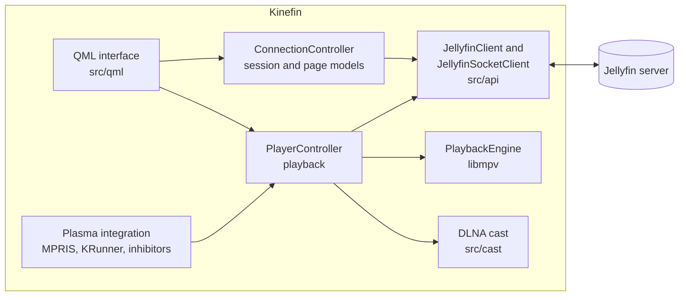

# Architecture

## Contents

- [Bird's-eye view](#birds-eye-view)
- [Entry points](#entry-points)
- [Code map](#code-map)
- [Invariants](#invariants)
- [Cross-cutting concerns](#cross-cutting-concerns)
- [Decisions](#decisions)
- [Where to start](#where-to-start)

Kinefin is a native KDE Plasma client for Jellyfin servers: a Kirigami interface in QML on top of C++ models, its own client for the Jellyfin REST and WebSocket APIs, and playback by libmpv inside the window.

This page is a map for contributors: where things live, how they connect, and the rules that keep them apart. How to build, test and check the code is in [CONTRIBUTING.md](../CONTRIBUTING.md). What each setting does is in the [settings reference](settings.md).

## Bird's-eye view

The interface shows what two controllers expose. `ConnectionController` owns the session with the server and the models behind every page. `PlayerController` owns playback, wherever it happens: in the window, in the mini player or picture-in-picture, or on a DLNA device. Both reach the server's REST and WebSocket APIs only through the API client. Images go through `src/imagecache`, and mpv opens the media stream itself.

## Entry points

| Where | What it does |
| --- | --- |
| `src/main.cpp` | Parses the command line, keeps the app a single instance (`KDBusService`), opens the profile, creates `ConnectionController`, `PlayerController`, `SyncPlayController` and the Plasma integrations, then loads `Main` from the `org.kde.kinefin` QML module |
| `src/qml/Main.qml` | The window: page stack, header, player, notifications. It follows the connection state: the Servers page, the user picker, sign-in, then Home |
| `ConnectionController` (`src/app/`) | Server choice, sign-in, the saved users and the models of Home, the libraries, search, Favorites, playlists and downloads |
| `PlayerController` (`src/player/`) | The playback API that QML, MPRIS, the remote-control socket and SyncPlay all use |

## Code map

The directories build into static libraries (`kinefin_core`, `kinefin_player`, `kinefin_cast`, `kinefin_integration`, `kinefin_ui`) that the app and the tests link alike; `CMakeLists.txt` lists which file goes where.

| Directory | Responsibility |
| --- | --- |
| `src/api/` | `JellyfinClient`: discovery, sign-in and Quick Connect, listings, `PlaybackInfo` with the device profile, media source choice, playback reports, subtitles and user data. `JellyfinSocketClient`: the server's WebSocket. The SyncPlay wire format. No UI types |
| `src/settings/` | Profiles and their paths, the per-profile settings file, the one table of client settings (`SettingDefinitions`), saved servers, and tokens in KWallet |
| `src/models/` | The `QAbstractItemModel` classes behind the pages: Home rows, library listings with filters and sort, item details, search, Favorites, the queue, playlists, downloads |
| `src/imagecache/` | The only code that fetches images, with its own allowlist and disk cache |
| `src/downloads/` | The download queue and transfers, per-series rules, export, and the watched-state changes made offline that wait for the server |
| `src/player/` | `PlaybackSession` (the lifecycle of one playback and when to report it), `PlaybackEngine` (libmpv through mpvqt), `PlayerController`, and the pieces they share: settings mapped to mpv, the bitrate fallback, trickplay previews, clip export, per-series track choices |
| `src/syncplay/` | SyncPlay groups: the server clock, the group queue and following the group |
| `src/cast/` | DLNA cast: SSDP discovery, device descriptions, SOAP control of a renderer, and `CastController` |
| `src/integration/` | Plasma and desktop integration: MPRIS, the KRunner runner, screensaver and suspend inhibition, the remote-control socket, `jellyfin://` links, gamepads (SDL3) with spatial navigation, the update check |
| `src/app/` | Glue between C++ and QML: `ConnectionController`, QML singletons and helpers, the mpv video item |
| `src/qml/` | The interface, one file per page, dialog or reusable control |
| `tests/` | QtTest suites against a fake Jellyfin server (`FakeJellyfin.h`); `test_ui_pages` loads the real `Main.qml` offscreen; `test_jellyfin_live` runs against a real server when the `KINEFIN_LIVE_*` variables are set. The UI tests fail on any QML warning |

## Invariants

These hold everywhere; a change that breaks one needs a reason good enough to change this page.

- Server text is data, never markup. Item names, overviews and every other string from the server are shown as plain text: every QML label that shows one sets `textFormat: Text.PlainText`, and `test_ui_pages` fails otherwise.
- Images come only from the server's own address. Only the image URL builders of `JellyfinClient` build an image URL, a raw server string is never an `Image` source, and `src/imagecache` is the one fetcher.
- The access token travels only in the `Authorization` header: never in a URL, a log line or a file.
- Each listing consumer has its own channel number. A page that lists items passes its channel with each request and gets it back with the answer; the client keeps one request in flight per channel. Two consumers never share one, and a consumer that goes away releases its channel.
- Models do not know about views: `kinefin_core`, which holds `src/models`, links neither QtGui nor QtQml.
- Settings live in one table. `SettingDefinitions` defines every client setting with its key, type, default and values; the Settings page, validation and the settings reference all follow it, and a test checks the reference against it.

## Cross-cutting concerns

| Concern | How it is handled |
| --- | --- |
| Profiles and data | Each profile has its own data and cache folders, listed in the [user guide](user-guide.md#where-kinefin-keeps-its-files); `src/settings` resolves them |
| Translations | Every visible string is an `i18n()` call; `po/extract.sh` builds the catalog and `scripts/po.py` reports what is left to translate |
| Interface rules | The interface follows the KDE Human Interface Guidelines and uses Kirigami controls; the desktop style is `org.kde.desktop` under `QApplication` |
| Playback contract | The settings and their mpv mapping, the device profile that decides when the server transcodes, and the playback reports follow Jellyfin Desktop wherever a native player allows |

## Decisions

| Decision | Reason |
| --- | --- |
| A native client, no web view | A Plasma app with Plasma's look, keyboard and accessibility, instead of a wrapper around the web client |
| A clean-room implementation | No code is copied from Jellyfin Desktop or jellyfin-web; Kinefin follows their behaviour, not their sources |
| libmpv through mpvqt | The same player as Jellyfin Desktop, drawn in the Qt Quick scene |
| Flatpak only, Linux only | One build to test and support, with its runtime pinned |
| Movies and TV series first | Music and audiobooks come after the video features are complete |

## Where to start

1. Build and run the checks as [CONTRIBUTING.md](../CONTRIBUTING.md) describes.
2. Read `src/main.cpp`, then `src/qml/Main.qml`, to see how the app starts and which page shows when.
3. Follow one feature through its layers. A good first one is item details: `ItemDetailsPage.qml`, then `ItemDetailsModel`, which asks `JellyfinClient::fetchItems` for the item on its own channel.
