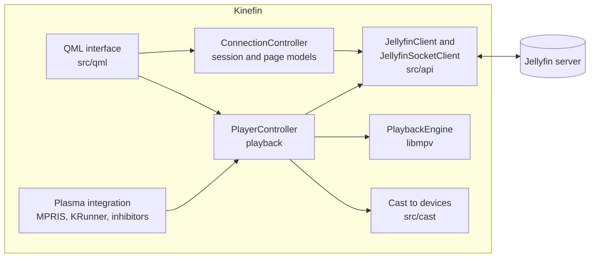
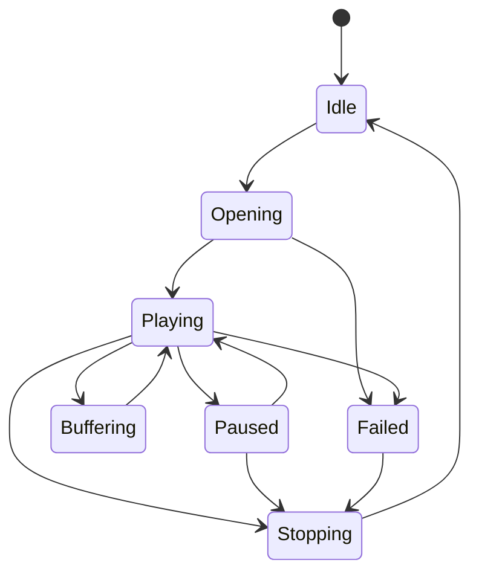

# Architecture

## Contents

- [Bird's-eye view](#birds-eye-view)
- [Entry points](#entry-points)
- [Code map](#code-map)
- [Invariants](#invariants)
- [Cross-cutting concerns](#cross-cutting-concerns)
- [Listing channels](#listing-channels)
- [Playback session](#playback-session)
- [Realtime connection](#realtime-connection)
- [Integration surfaces](#integration-surfaces)
- [Downloads on disk](#downloads-on-disk)
- [Casting](#casting)
- [Server compatibility](#server-compatibility)
- [Decisions](#decisions)
- [Deliberate exceptions to the KDE HIG](#deliberate-exceptions-to-the-kde-hig)
- [Known limitations](#known-limitations)
- [Where to start](#where-to-start)

Kinefin is a native KDE Plasma client for Jellyfin servers: a Kirigami interface in QML on top of C++ models, its own client for the Jellyfin REST and WebSocket APIs, and playback by libmpv inside the window.

This page is a map for contributors: where things live, how they connect, and the rules that keep them apart. How to build, test and check the code is in [CONTRIBUTING.md](../CONTRIBUTING.md). What each setting does is in the [settings reference](settings.md).

## Bird's-eye view

The interface shows what two controllers expose. `ConnectionController` owns the session with the server and the models behind every page. `PlayerController` owns playback, wherever it happens: in the window, in the mini player or picture-in-picture, or on a DLNA or Google Cast device. Both reach the server's REST and WebSocket APIs only through the API client. Images go through `src/imagecache`, and mpv opens the media stream itself.

## Entry points

| Where                               | What it does                                                                                                                                                                                                                                                |
| ----------------------------------- | ----------------------------------------------------------------------------------------------------------------------------------------------------------------------------------------------------------------------------------------------------------- |
| `src/main.cpp`                      | Parses the command line, keeps the app a single instance (`KDBusService`), opens the profile, creates `ConnectionController`, `PlayerController`, `SyncPlayController` and the Plasma integrations, then loads `Main` from the `org.kde.kinefin` QML module |
| `src/qml/Main.qml`                  | The window: page stack, header, player, notifications. It follows the connection state: the Servers page, the user picker, sign-in, then Home                                                                                                               |
| `ConnectionController` (`src/app/`) | Server choice, sign-in, the saved users and the models of Home, the libraries, search, Favorites, playlists and downloads                                                                                                                                   |
| `PlayerController` (`src/player/`)  | The playback API that QML, MPRIS, the remote-control socket and SyncPlay all use                                                                                                                                                                            |

## Code map

The directories build into static libraries (`kinefin_core`, `kinefin_player`, `kinefin_cast`, `kinefin_integration`, `kinefin_ui`) that the app and the tests link alike; `CMakeLists.txt` lists which file goes where.

| Directory                 | Responsibility                                                                                                                                                                                                                                                            |
| ------------------------- | ------------------------------------------------------------------------------------------------------------------------------------------------------------------------------------------------------------------------------------------------------------------------- |
| `src/api/`                | `JellyfinClient`: discovery, sign-in and Quick Connect, listings, `PlaybackInfo` with the device profile, media source choice, playback reports, subtitles and user data. `JellyfinSocketClient`: the server's WebSocket. The SyncPlay wire format. No UI types           |
| `src/settings/`           | Profiles and their paths, the per-profile settings file, the one table of client settings (`SettingDefinitions`), saved servers, and tokens in the keyring (`KeychainTokenStore`)                                                                                                                   |
| `src/models/`             | The `QAbstractItemModel` classes behind the pages: Home rows, library listings with filters and sort, item details, search, Favorites, the queue, playlists, downloads                                                                                                    |
| `src/imagecache/`         | The only code that fetches images, with its own allowlist and disk cache, and the BlurHash decoder                                                                                                                                                                                                  |
| `src/downloads/`          | The download queue and transfers, per-series rules, export, and the watched-state changes made offline that wait for the server                                                                                                                                           |
| `src/player/`             | `PlaybackSession` (the lifecycle of one playback and when to report it), `PlaybackEngine` (libmpv through mpvqt), `PlayerController`, and the pieces they share: settings mapped to mpv, the bitrate fallback, trickplay previews, clip export, per-series track choices  |
| `src/syncplay/`           | SyncPlay groups: the server clock, the group queue and following the group                                                                                                                                                                                                |
| `src/cast/` (shared)      | Cast to devices: `CastController` drives the active device through the `CastRenderer` interface; `CastNetwork` (the interfaces a multicast search uses) and `StreamProbe` (the token-less probe of a direct-play URL)                                                     |
| `src/cast/` (DLNA)        | SSDP discovery, device descriptions, SOAP control of a renderer                                                                                                                                                                                                           |
| `src/cast/` (Google Cast) | `Mdns` discovery, `CastChannel` (the Cast V2 channel and its heartbeat), `CastDeviceAuth` (device authentication on libcrypto), `CastProto` (CASTV2 framing and protobuf), `CastSender` (the Default Media Receiver session), `CastProfile` (the device profile by model) |
| `src/integration/`        | Plasma and desktop integration: MPRIS, the KRunner runner, screensaver and suspend inhibition, the remote-control socket, `jellyfin://` links, gamepads (SDL3) with spatial navigation                                                                                    |
| `src/app/`                | Glue between C++ and QML: `ConnectionController`, QML singletons and helpers, the mpv video item                                                                                                                                                                          |
| `src/qml/`                | The interface, one file per page, dialog or reusable control                                                                                                                                                                                                              |
| `tests/`                  | QtTest suites against a fake Jellyfin server (`FakeJellyfin.h`); `test_ui_pages` loads the real `Main.qml` offscreen; `test_jellyfin_live` runs against a real server when the `KINEFIN_LIVE_*` variables are set. The UI tests fail on any QML warning                   |

## Invariants

These hold everywhere; a change that breaks one needs a reason good enough to change this page.

- Server text is data, never markup. Item names, overviews and every other string from the server are shown as plain text: every QML label that shows one sets `textFormat: Text.PlainText`, and `test_ui_pages` fails otherwise.
- Images come only from the server's own address. Only the image URL builders of `JellyfinClient` build an image URL, a raw server string is never an `Image` source (the one local source is `image://blurhash/`, a picture decoded from a validated hash with no request), and `src/imagecache` is the one fetcher. The Identify covers and the provider thumbnails of the online image page of Edit Images are the one exception: the provider's own artwork, only over https and only on the TMDB, TheTVDB, OMDb, Fanart.tv or Cover Art Archive domains, fetched with no Authorization header or cookies, no redirects and the same size cap. The full-size URL of a provider image never leaves the API client: the model of the online image page holds an opaque offer id (QML never gets one). A thumbnail reaches an `Image` only as the URL the model kept after `isProviderImageUrl` accepted it. A download sends the server only a URL the server itself offered for that item and type in the current session.
- The access token travels only in the `Authorization` header: never in a URL, a log line or a file.
- Listing requests follow the channel rules in [Listing channels](#listing-channels).
- Models do not know about views: `kinefin_core`, which holds `src/models`, links neither QtGui nor QtQml.
- Settings live in one table. `SettingDefinitions` defines every client setting with its key, type, default and values; the Settings page, validation and the settings reference all follow it, and a test checks the reference against it.

## Cross-cutting concerns

| Concern           | How it is handled                                                                                                                                                                                                                                                                                                             |
| ----------------- | ----------------------------------------------------------------------------------------------------------------------------------------------------------------------------------------------------------------------------------------------------------------------------------------------------------------------------- |
| Profiles and data | Each profile has its own data and cache folders, listed in the [user guide](user-guide.md#where-kinefin-keeps-its-files); `src/settings` resolves them                                                                                                                                                                        |
| Translations      | Every visible string is an `i18n()` call; `po/extract.sh` builds the catalog and `scripts/po.py` reports what is left to translate                                                                                                                                                                                            |
| Interface rules   | The interface follows the KDE Human Interface Guidelines and uses Kirigami controls; the desktop style is `org.kde.desktop` under `QApplication`. A menu or combo box list that a button opens is placed by `PopupPlacement`, below the button or above it when there is no room, never over it; a menu at the pointer is not. Every drop-down list except the `FormCard.FormComboBoxDelegate` rows of the settings is a `ChoiceBox`, a combo box whose list is a menu of plain-text rows, so server names never read as markup |
| Playback contract | The settings and their mpv mapping, the device profile that decides when the server transcodes, and the playback reports follow Jellyfin Desktop wherever a native player allows                                                                                                                                              |

## Listing channels

A listing family keeps one request in flight per channel, and its signals carry the channel back with the answer. A consumer never shares a channel with another and calls `releaseListingChannel` when it goes away (this covers the Genres, Filters, RemoteImages and RemoteImageProviders families too). The constants live next to each consumer; the ranges are disjoint.

| Channel            | Consumer                                                                                                   |
| ------------------ | ---------------------------------------------------------------------------------------------------------- |
| 0                  | Home Continue Watching and Next Up                                                                         |
| 1                  | The library opened from a Home tile that is no tab (collections)                                           |
| 2 to 5             | Search groups                                                                                              |
| 6, 7               | Movies tab, TV Shows tab                                                                                   |
| 8                  | The Continue Watching page                                                                                 |
| 9                  | Home Favorites row                                                                                         |
| 10 and up          | Home Recently Added, one per library                                                                       |
| 1024 to 1026, 1027 | Genre rail slots, the genre list of the rails                                                              |
| 2048, 2049         | Queue expansion, queue restore                                                                             |
| 3072 to 3078       | Library sub-tabs: movie list, show list, recommendations, suggestions, upcoming, networks, episode counter |
| 3082               | Global Favorites scan                                                                                      |
| 4096               | The episodes of a series played alone                                                                      |
| 5120 to 5123       | Playlists, the playlist page, the Add to Playlist check, the SyncPlay group queue                          |
| 6144, 6145         | KRunner titles, KRunner episodes                                                                           |
| 6146               | The movies, series and episodes of a person                                                                |
| 6147               | The BoxSets an Add to Collection lists                                                                     |
| 7168 and up        | Edit Images pages, one per model (the images of the item, the offers of the providers)                     |
| 65536 and up       | Details pages, two per model (the item, its children below)                                                |

## Playback session

`PlaybackSession` (`src/player`) is a state machine with no Qt GUI or network dependency. It reaches the API client only through `PlaybackReporter`, an observer (the session takes any number), and mpv through `PlaybackEngine`. The coordinator owns the item id, media source id, play session id and the route; adapters deliver events into this one machine.

`failed()` is refused once the session is Stopping, so one session never yields two Stopped reports. A failure while opening has no started online session to report; a failure after an online stream opened keeps stop eligibility during teardown. `reset()` is for reconciled or emergency local cleanup. Stop, seek, source swap, failed transcode, reconnect, renderer handoff and shutdown clean up idempotently: the adapter attempts one best-effort remote stop when the online stream had started, even after `Failed`, and clears the identity only after local teardown.

| Route                  | What is reported                                                                                                                                                                                                                                                                                                                                                                                                                                                                                                                                                                                                                    |
| ---------------------- | ----------------------------------------------------------------------------------------------------------------------------------------------------------------------------------------------------------------------------------------------------------------------------------------------------------------------------------------------------------------------------------------------------------------------------------------------------------------------------------------------------------------------------------------------------------------------------------------------------------------------------------- |
| `Direct`, `Transcoded` | Progress from the session while it is active                                                                                                                                                                                                                                                                                                                                                                                                                                                                                                                                                                                        |
| `Offline`              | Local state only; a stop or error may enqueue a completed watched-state event for the server, and the durable outbox is reconciled on reconnect                                                                                                                                                                                                                                                                                                                                                                                                                                                                                     |
| `Cast`                 | The renderer's state, never local mpv: Start at its first `PLAYING`, Progress from its state (DLNA polled, Google Cast `MEDIA_STATUS` with an extrapolated position), one Stopped at its position (`Failed: true` after a failure, nothing if it never played). A seek is `Seek REL_TIME` or a transcode reloaded at the new start under the same play session, with one Progress per run of seeks. On reconnect DLNA keeps polling while the renderer answers and a foreign `TrackURI` ends the cast; Google Cast resumes with the same authenticated device and Kinefin's media session, else ends after 3 attempts or a takeover |

## Realtime connection

`JellyfinSocketClient` is one `QWebSocket` per signed-in identity, owned by `ConnectionController`. `JellyfinClient` stays the only owner of the base URL and the token: the socket asks for a fresh handshake request on every attempt and keeps nothing. The token travels only in the handshake `Authorization` header. A redirect is never followed, TLS is never downgraded, and a TLS error is ignored only while Ignore Certificate Errors is on. The socket never decides playback state: remote commands go to the playback coordinator, never to the reporter.

| Aspect      | Behaviour                                                                                                                                                                     |
| ----------- | ----------------------------------------------------------------------------------------------------------------------------------------------------------------------------- |
| States      | Disconnected, Connecting, Authenticated, Reconnecting; logout and credential loss go to Disconnected                                                                          |
| Timers      | Connect timeout 15 s; dead-peer timer 75 s, restarted by any inbound frame; `KeepAlive` at `min(Data/2, 30 s)` after a `ForceKeepAlive`                                       |
| Backoff     | Ceiling `min(60 s, 1 s * 2^n)`, delay uniform between half the ceiling and the ceiling; it keeps retrying at 60 s while REST says the token is valid, and a REST 401 stops it |
| After a gap | Entering Authenticated may follow missed events: after a gap of 30 s or more Home and the page in front read their data again. A network coming back reconnects at once       |
| Validation  | Text frames only, a JSON object whose `MessageType` is 1 to 64 letters; a bad frame is dropped, the connection stays open; a frame over 4 MiB closes with 1009 and reconnects |
| Ignored     | `ServerRestarting`, `ServerShuttingDown`, `RestartRequired`, `UserUpdated`, timer, scan, package and activity-log messages, and any unknown type                              |

`LibraryChanged` only wakes the downloads rule scanner. `UserDataChanged` is a hint, never data: the ids it names are read again from the server, at most 500 per round and at most once a second, and the answer reaches the models through the same signals as a local change.

## Integration surfaces

| Surface               | Name                                                                            | Notes                                                                                                                    |
| --------------------- | ------------------------------------------------------------------------------- | ------------------------------------------------------------------------------------------------------------------------ |
| MPRIS                 | `org.mpris.MediaPlayer2.Kinefin.profile_<id>`                                   | The `.` and `-` of the profile id become `_`; one per profile, the default included                                      |
| KRunner               | `io.github.the_beper.Kinefin.Runner` at `/runner`, interface `org.kde.krunner1` | The plugin file uses a wildcard, so KRunner never starts Kinefin; the Flatpak keeps the plugin off until you enable it   |
| Screen inhibition     | `org.freedesktop.ScreenSaver`                                                   | Held while playing (opening, loading and buffering count), released on pause, stop and exit; not while casting           |
| Suspend inhibition    | `org.freedesktop.portal.Inhibit`, suspend flag                                  | Held only while a cast plays, since the video is on another screen; the logind idle inhibitor is deliberately never held |
| Remote-control socket | A Unix socket                                                                   | Documented in [Control Kinefin from a script](user-guide.md#control-kinefin-from-a-script)                               |

## Downloads on disk

Everything is under `<data>/downloads/` of the profile, with private permissions. Item ids in a path must pass `isValidJellyfinId`; no server-derived name reaches a path.

| Path                                             | Content                                                                                                                                                                                                                                                |
| ------------------------------------------------ | ------------------------------------------------------------------------------------------------------------------------------------------------------------------------------------------------------------------------------------------------------ |
| `index.json`                                     | The queue, completed and tracked items, one record per owner and item. Written atomically; a malformed file is renamed `.broken` and the files show as untracked. Completed records are never dropped to make room: at the cap a new record is refused |
| `<server>/<user>/<item>/media.<ext>`             | The original file; `ext` is the validated container, else `bin`. While it downloads it is `media.part`                                                                                                                                                 |
| `<server>/<user>/<item>/media.kinefin-part.json` | The resume sidecar: ETag, HTTP validator, size and bytes written; a mismatch discards the partial                                                                                                                                                      |
| `<server>/<user>/<item>/info.json`               | The offline record: selected metadata, local position and played state, chapters and the subtitle files written                                                                                                                                        |
| `<server>/<user>/<item>/poster.jpg`              | The primary image, fetched through `ImageNetworkAccess`                                                                                                                                                                                                |
| `<server>/<user>/<item>/subs/<index>.<ext>`      | External text subtitles (`srt`, `ass`, `ssa`, `vtt`), fetched after the file completes                                                                                                                                                                 |
| `rules.json`                                     | Per-series automatic download rules and their cursors                                                                                                                                                                                                  |
| `outbox.json`                                    | Watched-state changes made offline that wait for the server; never merged across profiles or accounts                                                                                                                                                  |

## Casting

Cast to DLNA renderers and Google Cast devices lives in `src/cast` behind the `CastRenderer` interface. A renderer on the local network is untrusted, so these invariants hold for both:

- No token ever reaches a renderer. The media URL is checked token-free when the device is chosen and again in `load()`, and renderer traffic uses its own `QNetworkAccessManager` with no `Authorization`, cookies or proxy. Logs never hold a URL, a body or a payload.
- Before a direct play, one token-free `GET` with `Range: bytes=0-0` must answer 206. A 401 means the server now guards the route, and nothing is sent to the renderer.
- The user picks a listed device with its address shown; there is no auto-cast and no background discovery.
- Renderer data is bounded and plain text: SSDP datagrams 4 KiB and 32 devices; descriptions 64 KiB over `http` with no redirect and a DTD aborting the parse; SOAP replies 16 KiB; Cast frames and JSON 64 KiB; names stripped of control characters and cut at 64 characters. Sender addresses must be private link addresses and match the `LOCATION` host.
- The Flatpak gains no permission: SSDP and mDNS run on `--share=network`.

Jellyfin's own Cast receiver is not used. It refuses a message without an `accessToken`, calls the API with it, logs it and puts `api_key=` in stream URLs, and Jellyfin 12.4 has no token scoped to one item or expiring. Google Cast plays on the Default Media Receiver with token-free URLs instead.

Accepted exposures:

- A renderer that gets the URL can replay it: it is the server's anonymous stream route, which exists without casting, with no expiry or revocation.
- A renderer can report a false position, which can mark the item played.
- The first UDN or Cast id seen wins, so a LAN host can shadow a device within one search; the address shown beside the name is the mitigation.
- Google Cast device authentication checks no CRL, so extracted device keys pass, and the leaf is pinned only for reconnects within one cast, not across casts.
- A server that adds authorization to its stream routes would make the range probe fail and block direct-play casts.

| Choice                                                                                         | Reason                                                                                                          |
| ---------------------------------------------------------------------------------------------- | --------------------------------------------------------------------------------------------------------------- |
| Hand-written mDNS on `QUdpSocket`                                                              | It needs no permission; KDNSSD gives a host name but no IP                                                      |
| `libcrypto` for device authentication                                                          | `QSslCertificate::verify` uses the process-wide CA list and Qt has no RSA verification API                      |
| Text subtitles as one WebVTT track, image subtitles burnt in                                   | Burning in forces a transcode, which loses native seeking and the duration                                      |
| The DNS rule: an `http` server whose name resolves to a private IPv4 is sent as the IP literal | Chromecasts resolve through 8.8.8.8 and ignore the DHCP DNS; an `http` reverse proxy that routes by Host breaks |
| A new `PlaySessionId` at each transcode seek                                                   | The server names the job's output file after the id and serves the earlier file again for the same id           |

Rejected: GENA as the source of truth (inbound TCP, and positions are not evented), HLS to renderers (it needs the token), a relay proxy as the default (every byte through the client machine and the server's route still open), the server's DLNA PlayTo (an admin plugin that puts `ApiKey` in the renderer's URL).

## Server compatibility

Jellyfin 12.4 or later only; older servers get no version probes or fallbacks. Legacy authorization is off on 12.x, so only the `Authorization: MediaBrowser ...` header works and Kinefin sends nothing else. Quick Connect initiation is a `POST`. The HLS routes are outside the OpenAPI spec: Kinefin never builds an HLS URL and uses the server-issued `TranscodingUrl`.

Behaviours of 12.4 that no single function owns:

| Route                                    | Behaviour                                                                                                                          |
| ---------------------------------------- | ---------------------------------------------------------------------------------------------------------------------------------- |
| `Items/Latest`, `Movies/Recommendations` | Return a bare array, not an envelope                                                                                               |
| `Shows/{id}/Episodes` without `seasonId` | A long series can exceed the 1 MiB reply cap, so it is read in pages                                                               |
| `Items` with `searchTerm`                | The server orders by relevance whatever `sortBy` says, and `TotalRecordCount` is the smaller of the real count and 3 times `limit` |
| `Items/Suggestions`                      | The total is the page size unless `enableTotalRecordCount=true`                                                                    |
| `Items/Filters2`                         | Without `includeItemTypes` it lists no languages                                                                                   |
| `Items` without `parentId`               | Includes items of libraries hidden by `MyMediaExcludes`; the server applies that exclusion only to `/UserViews`                    |
| A combined search of titles and episodes | A common word returns only episodes, which is why the KRunner runner sends two requests                                            |

## Decisions

| Decision                                                                          | Reason                                                                                                                                                                                                                                                                                        |
| --------------------------------------------------------------------------------- | --------------------------------------------------------------------------------------------------------------------------------------------------------------------------------------------------------------------------------------------------------------------------------------------- |
| Wayland only, no X11                                                              | Every target desktop is Wayland; the Flatpak has no `fallback-x11` socket and mpv is built with X11 disabled                                                                                                                                                                                  |
| No display mode or refresh-rate switching                                         | KWin persists every applied mode, libkscreen is not in the KDE runtime, and a crash would leave the display at the film's rate with nothing in the sandbox to restore it                                                                                                                      |
| `MediaSource.Path` is never played                                                | All media goes through the server, with the token in the header, never a path the server reports                                                                                                                                                                                              |
| No tray icon, no LIRC, no TV mode                                                 | Jellyfin Desktop has no tray icon on Linux; the 10-foot layout is declined. Server administration is one button that opens the web dashboard in the browser                                                                                                                                   |
| The core is C++                                                                   | Kirigami, KF6 and QML are C++-first, and `KDBusService`, `KConfig` and the MPRIS and screensaver services come free; a Rust core would need `cxx-qt` glue for all of them and one more toolchain to pin per release. The memory-unsafe part of a media client is libmpv, not the Qt models    |
| Settings are one form in the main window, not Kirigami Addons `ConfigurationView` | `ConfigurationView` opens a separate modal window and has no hook to veto a switch while a draft is unsaved                                                                                                                                                                                   |
| The interface scale is read before QApplication exists                            | Qt reads `QT_SCALE_FACTOR` only while `QApplication` is constructed, and scaling the application font alone leaves `Kirigami.Units`, so the cards, the spacing and the navigation rail, unchanged. `startupUiScalePercent` reads `main.uiScale` from the profile's `kinefin.conf` before the application object exists, choosing the profile like the rest of the start does, and `main` exports the result as `QT_SCALE_FACTOR` unless the environment already sets it |
| Picture-in-picture uses KWin's `xx_pip_v1` surface                                | It is the only automatic keep-above on KWin; other window kinds are no-ops on Wayland. KWin's bugs in resizing ([512314](https://bugs.kde.org/show_bug.cgi?id=512314)) and window rules ([511384](https://bugs.kde.org/show_bug.cgi?id=511384)) for this surface are marked resolved upstream |
| The picture-in-picture window fits itself to the video's shape                    | The protocol has no aspect-ratio request and KWin resizes the window to any shape, so `PipSurface` fits every size it is configured with to the video's shape (`fitToAspect`), led by the edge being dragged, inside KWin's bounds. The shape is mpv's display size (`dwidth`, `dheight`), so the Aspect Ratio choices that force a shape (4:3, 16:9, Widescreen for 4:3 Video) count and Zoom, Stretch and Original Size do not |
| The picture-in-picture window's shadow is drawn by the compositor                 | The window is a surface of its own, so QML cannot draw outside it: `PipSurface` gives the compositor the eight tiles of a Gaussian shadow (`pipShadow`) through `KWindowShadow` (KWin's `org_kde_kwin_shadow`). The mini player draws a `Kirigami.ShadowedRectangle` with the same size, offset and opacity, so the two look alike |
| Video frames start rendering 10 ms before they are due (`video-timing-offset=0.01`) | libmpv's render call sleeps until the frame is due, which with mpv's default of 50 ms put the thread that also draws the interface to sleep for up to 50 ms a frame. Measured with `QSG_RENDER_TIMING`: at 50 ms (mpv's default), 25% of the interface frames took 24 ms on average and 10% of the gaps between frames passed 33 ms; at 10 ms, 2% took 6.5 ms and 3% passed 33 ms (one display, one film, scrolling beside the playing video in the installed Flatpak). An `mpv.conf` line replaces the default |
| The details cover is sized to the view, behind a BlurHash placeholder              | The page asks the server for the backdrop at 640, 960, 1280 or 1920 px, the smallest step that covers the view in device pixels (`ItemDetailsModel::backdropUrlFor`): the server resizes and sends no more than the view needs, and a window resize asks again only when it crosses a step. The first visit of a film still waits for the server to resize its image (130 to 690 ms in one measurement with an empty cache, a few ms afterwards). Meanwhile the page draws the item's own `ImageBlurHashes` entry for the backdrop (`image://blurhash/`, `BlurHashImageProvider`, a picture of 32 by 18 pixels that needs no request) and fades the backdrop in over it; the photos of the cast ask the server once the cover has come, has failed or 2.5 s have passed. The hash is server data: it is checked (base 83 characters, a grid of at most 9 by 9 and the length it needs, `isValidBlurHash`), decoded within 64 by 64 pixels, and passed to the provider as hexadecimal digits, never as markup or a path |
| A clip from a stream is cut from mpv's `ab-loop-dump-cache`                       | A second reader of the transcoding URL would move the server's ffmpeg job. The command may be removed upstream, which would end clips from a transcode                                                                                                                                        |
| A native client, no web view                                                      | A Plasma app with Plasma's look, keyboard and accessibility, instead of a wrapper around the web client                                                                                                                                                                                       |
| A clean-room implementation                                                       | No code is copied from Jellyfin Desktop or jellyfin-web; Kinefin follows their behaviour, not their sources                                                                                                                                                                                   |
| libmpv through mpvqt                                                              | The same player as Jellyfin Desktop, drawn in the Qt Quick scene                                                                                                                                                                                                                              |
| Flatpak only, Linux only                                                          | One build to test and support, with its runtime pinned                                                                                                                                                                                                                                        |
| Movies and shows first                                                            | Music and audiobooks come after the video features are complete                                                                                                                                                                                                                               |

## Deliberate exceptions to the KDE HIG

The [KDE HIG](https://develop.kde.org/hig/) is followed otherwise. This table is the only owner of the exceptions; add a new one here in the same change.

| Exception                                                                                                                                                         | Reason                                                                                                                                                                                                                                                                                                                                                                                            |
| ----------------------------------------------------------------------------------------------------------------------------------------------------------------- | ------------------------------------------------------------------------------------------------------------------------------------------------------------------------------------------------------------------------------------------------------------------------------------------------------------------------------------------------------------------------------------------------- |
| Playback is app-modal: the player page covers the window with its own floating bars and no toolbar                                                                | The HIG has no media playback page pattern; Elisa and Kodi do the same. The window header and the rail stay in place, faded and hidden from screen readers while the player is in front. The boxes of the player, the mini player and the picture-in-picture window (Back, the corner buttons, the bottom panel) share one look, `OsdBox`                                                                                                                                                                                                            |
| Settings use kirigami-addons `FormCard`, not `Kirigami.FormLayout`                                                                                                | `FormCard` survives the long help texts and translations of the client settings, as in KuickShare. It is a runtime dependency, and `FormCard` delegates are avoided inside Repeaters                                                                                                                                                                                                              |
| Setting labels keep Jellyfin Desktop's names and title case                                                                                                       | The settings contract promises the same names, which wins over sentence case for control labels; choice texts inside lists are sentence case                                                                                                                                                                                                                                                      |
| The page stack pins the plain toolbar header                                                                                                                      | Kirigami's automatic style resolves to the breadcrumb in narrow mode, and the breadcrumb renders titles without plain-text formatting while library names are server text. A narrow Plasma Mobile layout has no breadcrumbs                                                                                                                                                                       |
| Series and season on an episode or season page are flat `ToolButton`s with their own content and background, not links | The HIG sends internal navigation through buttons, and a `LinkButton` is blue and underlined over a photo. The desktop style draws a button's text in its own background, so the background is replaced too: nothing at rest, a tint under the pointer, an underline and a ring for the keyboard focus. The name comes from the server: its label is plain text and the button takes no mnemonic from it |
| The toolbar has no Forward button and the mouse forward button is ignored                                                                                         | Back destroys the page it leaves and gives its models' channels back, so there is no page to go forward to                                                                                                                                                                                                                                                                                        |
| Quit is reachable only by Ctrl+Q and the window's close button                                                                                                    | The HIG forbids Quit in a hamburger menu and the one header menu has none; the Keyboard Shortcuts dialog lists Ctrl+Q                                                                                                                                                                                                                                                                             |
| Navigation is a left rail of `Kirigami.NavigationTabButton` (`ShellSidebar`) with a custom background, not the stock `NavigationTabBar` or `GlobalDrawer`; a Compact window has a header button that opens a modal drawer with the same content (the entries, Search, the queue, the SyncPlay group and the user as rows) | The stock `NavigationTabBar` is a mobile footer with equal-width tabs and its own shortcuts. The `GlobalDrawer` cannot show a label under the icon, has no badge and resizes the page row, which ends the slide of a tab switch. The sections and their Ctrl+N shortcuts live in `ShellNavigation`, which no view duplicates. The Compact header keeps its Search button and its user menu, whose menu keeps Queue and the SyncPlay group, beside the drawer's rows of the same names, so that both are one click away without opening the drawer |
| Download rows use inline icon buttons instead of a menu | A menu of one or two entries is a click too many. A completed row has three buttons (Play, Export and Delete), more than the HIG's two inline icons. Cancel Download acts at once, though what the transfer had fetched goes with it, because the item can be queued again; Delete Download… asks first. The buttons take the keyboard through Tab, and the list keeps Return, Delete and the row click |
| Search is a popup opened from the rail, Ctrl+F, the Compact search button or the drawer's Search row, not a page or a header field                                                                                | Results are cards in four groups that must stay over the page in front, whose state and place the search leaves untouched; a result opens its details page above that page                                                                                                                                                                                                                         |
| Music and Audiobooks are rail entries whose pages say they are coming soon | Both are planned, and their place in the rail and their shortcuts are fixed now, so that the rail does not change when they arrive |
| The main menu button of a window with no rail shows the overflow icon, not the hamburger | The Compact header already has a hamburger that opens the sections, and two hamburgers would differ only by position |
| No card or row shows a focus ring until the first key or gamepad input | A page opens with a current item that nothing marks, and a click or a touch hides the ring again; the first key press shows it, so keyboard and gamepad use is never without a visible focus |
| The user menu, the queue and the SyncPlay group stand at the foot of the rail, not in the header                                                                  | They stay in reach whatever the height of the window while the sections scroll. The one menu button moves between the header and the rail, and its menu shows the user's avatar, stays under 12 entries and hides entries by permission and mode instead of disabling them. Orca, the Breeze look and right-to-left are unverified on a Plasma desktop |
| The library sub-tabs are checkable toolbar entries, not a tab bar                                                                                                 | A second tab bar beside the rail would be a third level of navigation. The HIG prefers a tab bar and discourages checkable buttons. Kirigami's `ActionToolBar` stacks its buttons in reverse, so Tab walks the toolbar right to left                                                                                                                                                            |
| Remote Sessions and Media Info are modal dialogs, not a page or an overlay sheet                                                                                  | Both are popups over the current page. The HIG reserves dialogs for immediate decisions and puts read-only scrollable content in an `OverlaySheet`; Media Info has a Copy button for the whole text                                                                                                                                                                                               |
| The Quick Controls style is `org.kde.desktop` under `QApplication`                                                                                                | A `QGuiApplication` resolves to `org.kde.breeze`, which repainted 165 frames per second while idle on a Plasma desktop (measured in the Flatpak with `QSG_RENDER_TIMING`)                                                                                                                                                                                                                         |
| The player's speaker button shows the volume slider instead of its tooltip                                                                                        | A "Mute" tooltip would open in the same place at the same moment, so it gives way while the popup is open; the text stays the accessible name. The wheel changes the volume anywhere over the player, the timeline included; the timeline keeps the keyboard and the drag for seeking                                                                                                             |
| Card-row arrows, a card's play disc and the mini player's buttons have no tooltip                                                                                 | A tooltip would cover the cards or spill over the small player; the text stays the accessible name                                                                                                                                                                                                                                                                                                |
| The rows of the Queue and Playlist pages move and go only through their menu and keys                                                                             | The row menu (right click, Menu, Shift+F10) holds Move Up, Move Down and Remove, with Ctrl+Up, Ctrl+Down and Delete. There is no drag handle and no per-row buttons, which would crowd a list row                                                                                                                                                                                                 |
| New Playlist… and New Collection… close the picker and open the name dialog; the Delete confirmation of Edit Subtitles replaces its edit dialog | The HIG asks never to open a dialog from a dialog; one dialog shows at a time                                                                                                                                                                                                                                                                                                                     |
| Export When Download Completes is shown disabled                                                                                                                  | The setting stays visible with its explanation, so the missing persistent portal grant is stated where you look for automatic export                                                                                                                                                                                                                                                              |
| Gamepad and remote arrows move the focus by on-screen geometry across groups, and leave closed combo boxes and spin boxes unchanged                               | A pad has no Tab and the focus chain follows declaration order, not the screen. The real keyboard keeps Qt's arrows and Tab order, apart from Up and Down out of a card row or a library tile. There is still no 10-foot layout                                                                                                                                                                   |
| Continue Watching cards carry a Mark as Watched button that shows only on hover, with no keyboard focus                                                           | A keyboard, pad or touch user reaches the same action in the card's menu (Menu, Shift+F10 or a long press), whose notification has Undo                                                                                                                                                                                                                                                           |
| Kinefin installs its own action icon, `kinefin-cast`                                                                                                              | Breeze 6.11 has no cast icon. It ships in hicolor at 16 and 22 px with the `ColorScheme-Text` stylesheet, which KIconLoader recolours like a Breeze icon                                                                                                                                                                                                                                          |
| The filter dialog's exclusive sections (Played or Unplayed, HD or SD) are checkboxes, not radio buttons                                                           | Each section must be able to have nothing chosen, which means no filter; radio buttons cannot go back to that without an "Any" entry, and jellyfin-web has the same checkboxes. The dialog is a facet list beside the values of the current facet, never a second view                                                                                                                            |
| The Saved Filters dialog opens over the Filters dialog                                                                                                            | Saving keeps the Filters dialog's draft, so it has to stay open under it, and choosing a set closes both. A pane inside the Filters dialog would need a facet of its own and the dialog's keys all assume values to check. Revisit if a second kind of saved thing comes                                                                                                                          |
| The Filters dialog draws its buttons in the last row of its body, not in the dialog footer                                                                        | The line between the facets and their values has to run down to the bottom edge, with Saved Filters in the left column on the same row as the buttons. The footer of a Kirigami dialog spans the whole width under the body, so it could neither continue that line nor share its row with the list's column                                                                                      |
| The player's Subtitles menu has no icons                                                                                                                          | One icon makes the style reserve an icon column for every entry, which put the subtitle names far from their radio buttons, unlike the other radio menus of the player                                                                                                                                                                                                                            |
| The user picker and the sign-in page lay their tiles out with `Flow` and `Repeater`, not `GridView`                                                               | The tiles form centred rows whose last, partial row stays centred and wraps with the width of the page, which a `GridView` cannot do: its cells start at the leading edge. The tiles are one tab stop with the arrow keys inside, as in a list                                                                                                                                                    |

## Known limitations

| Limitation                                              | Detail                                                                                                                                                                                                                                                                                                  |
| ------------------------------------------------------- | ------------------------------------------------------------------------------------------------------------------------------------------------------------------------------------------------------------------------------------------------------------------------------------------------------- |
| A token stays after a failed keyring removal            | There is no retry, and sign-out does not call `POST /Sessions/Logout`, so the token stays valid on the server                                                                                                                                                                                           |
| Keyring entries are keyed by server-reported ids        | A hostile server claiming another id can overwrite that entry; the effect is denial of service only                                                                                                                                                                                                     |
| The keyring has no timeout                              | A Secret portal that never answers leaves the operation pending, and every operation queued behind it                                                                                                                                                                                                   |
| No Secret portal                                        | Sessions are kept in memory only and are not saved (see the [user guide](user-guide.md#sign-in))                                                                                                                                                                                                        |
| A saved plain-HTTP server skips the confirmation dialog | A host that takes over the saved address and repeats the server id, which is public, receives the stored token at an automatic restore. Over plain HTTP the token already travels in clear, so asking again would not stop an active attacker. See [SECURITY.md](../SECURITY.md#scope-and-threat-model) |

## Where to start

1. Build and run the checks as [CONTRIBUTING.md](../CONTRIBUTING.md) describes.
2. Read `src/main.cpp`, then `src/qml/Main.qml`, to see how the app starts and which page shows when.
3. Follow one feature through its layers. A good first one is item details: `ItemDetailsPage.qml`, then `ItemDetailsModel`, which asks `JellyfinClient::fetchItems` for the item on its own channel.
