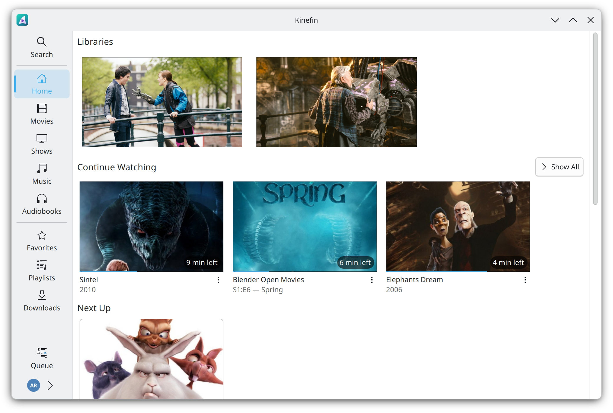
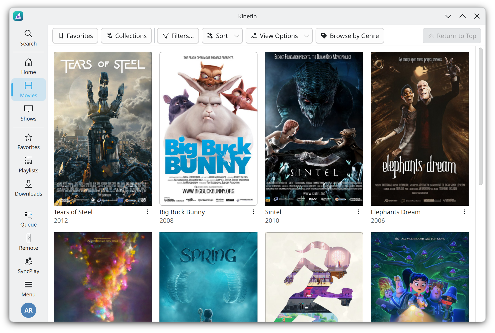
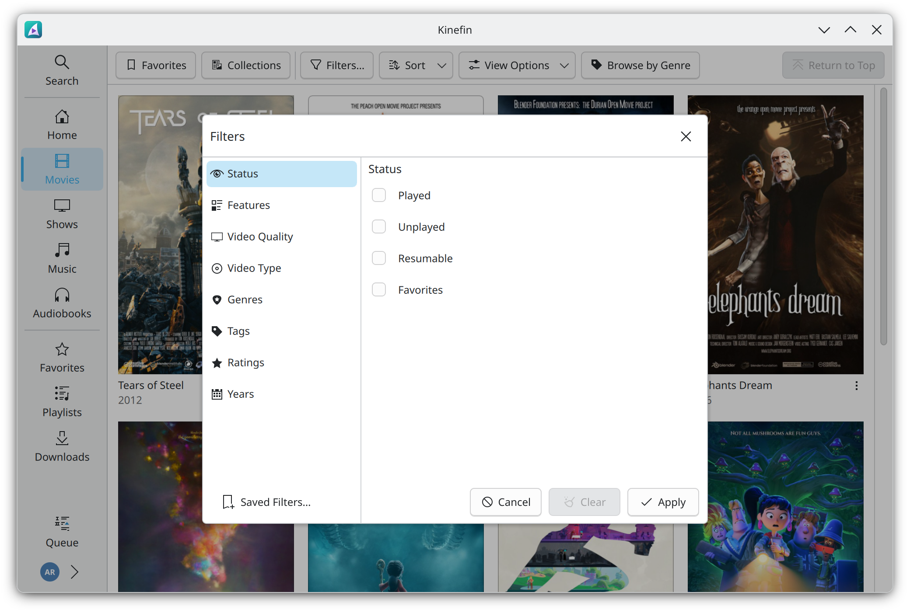
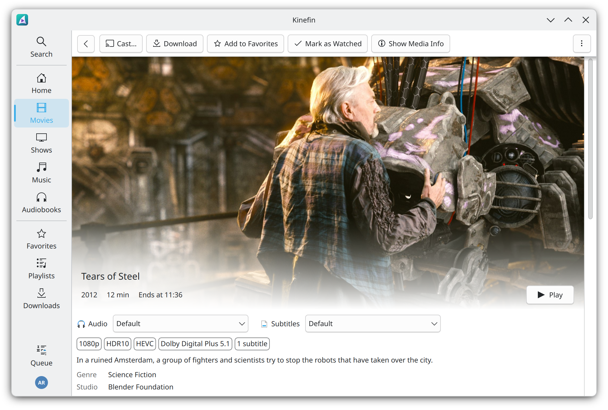
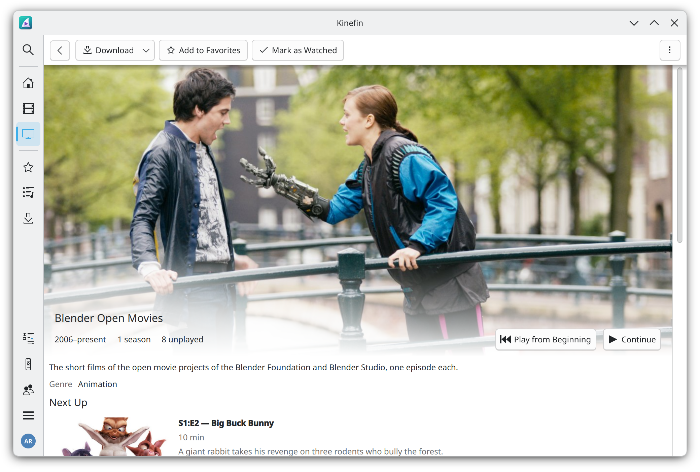
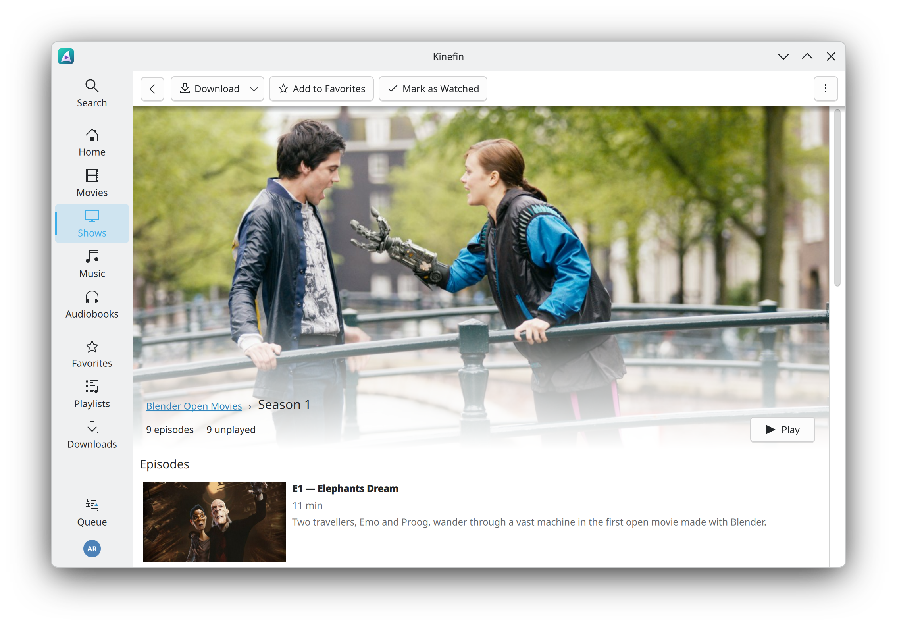
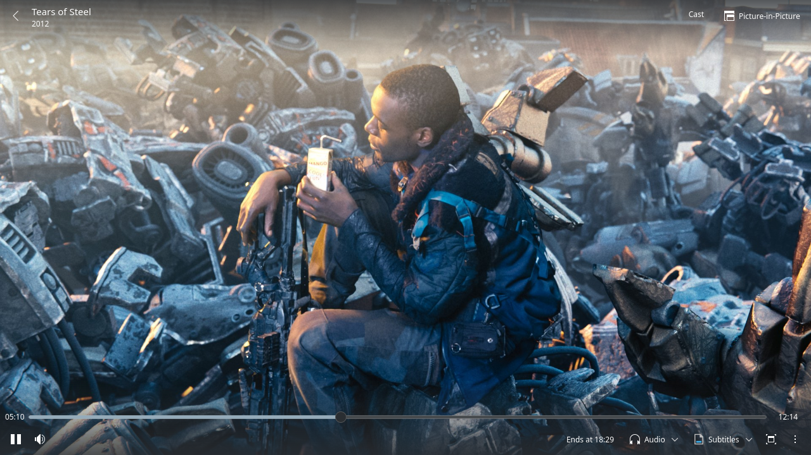
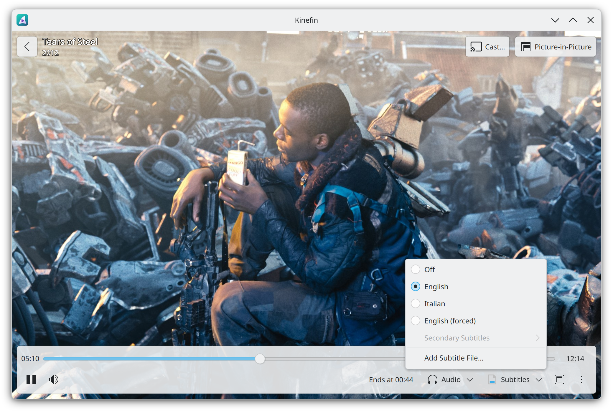

# Kinefin user guide

## Contents

- [What Kinefin is](#what-kinefin-is)
- [Install and update](#install-and-update)
  - [Install from the repository](#install-from-the-repository)
  - [Install from a bundle](#install-from-a-bundle)
  - [Check the signature](#check-the-signature)
  - [Uninstall](#uninstall)
- [Sign in](#sign-in)
  - [Add a server](#add-a-server)
  - [Test a server](#test-a-server)
  - [Sign in with a password or Quick Connect](#sign-in-with-a-password-or-quick-connect)
  - [Several users on one server](#several-users-on-one-server)
- [Browse](#browse)
  - [Home](#home)
  - [Act on a card](#act-on-a-card)
  - [Movies and Shows](#movies-and-shows)
  - [Show more library tabs](#show-more-library-tabs)
  - [Missing and unaired episodes](#missing-and-unaired-episodes)
  - [Item details](#item-details)
  - [Edit images](#edit-images)
  - [Search](#search)
  - [Favorites](#favorites)
  - [Playlists](#playlists)
  - [Queue](#queue)
- [Play](#play)
  - [Control playback](#control-playback)
  - [Audio and subtitle tracks](#audio-and-subtitle-tracks)
  - [Keep watching while you browse](#keep-watching-while-you-browse)
  - [Play the next item automatically](#play-the-next-item-automatically)
  - [Jump between chapters](#jump-between-chapters)
  - [Choose a quality](#choose-a-quality)
  - [Save a clip or a GIF](#save-a-clip-or-a-gif)
  - [Shaders and debanding](#shaders-and-debanding)
  - [Watch together with SyncPlay](#watch-together-with-syncplay)
  - [Control other sessions](#control-other-sessions)
- [Download for offline use](#download-for-offline-use)
  - [Automatic downloads for a series](#automatic-downloads-for-a-series)
  - [Export to a folder](#export-to-a-folder)
  - [Work offline](#work-offline)
- [Cast to another device](#cast-to-another-device)
- [Search from KRunner](#search-from-krunner)
- [Use the keyboard or a gamepad](#use-the-keyboard-or-a-gamepad)
  - [Keyboard](#keyboard)
  - [Gamepad (experimental)](#gamepad-experimental)
- [Control Kinefin from a script](#control-kinefin-from-a-script)
- [Troubleshooting](#troubleshooting)
  - [The server is not reachable](#the-server-is-not-reachable)
  - [Kinefin asks for the password again](#kinefin-asks-for-the-password-again)
  - [Playback stutters](#playback-stutters)
  - [A video transcodes when it should direct-play](#a-video-transcodes-when-it-should-direct-play)
  - [There is no sound over HDMI or S/PDIF passthrough](#there-is-no-sound-over-hdmi-or-spdif-passthrough)
  - [The Download actions are missing](#the-download-actions-are-missing)
  - [The Admin Dashboard entry is missing](#the-admin-dashboard-entry-is-missing)
  - [Search Online Subtitles… is missing](#search-online-subtitles-is-missing)
  - [A cast device is not listed](#a-cast-device-is-not-listed)
  - [A Google Cast device does not play](#a-google-cast-device-does-not-play)
  - [KRunner shows no Kinefin results](#krunner-shows-no-kinefin-results)
  - [The picture-in-picture window falls behind other windows](#the-picture-in-picture-window-falls-behind-other-windows)
- [Where Kinefin keeps its files](#where-kinefin-keeps-its-files)

## What Kinefin is

Kinefin is a native KDE Plasma client for Jellyfin media servers. The interface is built with Kirigami and the video is played by libmpv. It does not embed the Jellyfin web client.

It needs:

- A Jellyfin server you can sign in to. Kinefin is tested with Jellyfin 12.4.
- Plasma on Wayland.
- Flatpak, the only way Kinefin is packaged.

Kinefin covers movies and shows. Music and audiobooks are not built yet: those libraries show on Home but stay disabled with "Not supported yet", and their rail entries open a page that says they are coming soon.

Server administration is not part of Kinefin. If you are an administrator, **Admin Dashboard** in the main menu opens the server's web interface in your browser. User management, library management, plugins and Live TV setup happen there.

The [settings reference](settings.md) lists every setting with its default. Where a task needs one, this guide names it with its place in the app, such as **Settings**, **Video**.

## Install and update

Kinefin has no Flathub listing yet. It comes from its own signed Flatpak repository, `https://the-beper.github.io/Kinefin`.

### Install from the repository

Run:

```sh
flatpak install https://the-beper.github.io/Kinefin/kinefin.flatpakref
```

Opening that `.flatpakref` file in Discover does the same. It adds the repository as the remote `kinefin`, branch `stable`. Start Kinefin from the application launcher, or run `flatpak run io.github.the_beper.Kinefin`. A second launch does not open a second window. It raises the running one.

The KDE runtime comes from [Flathub](https://flathub.org/setup): set up the Flathub remote first if your system does not have it.

Updates come from Discover or `flatpak update`. Your servers, settings and downloads under `~/.var/app/io.github.the_beper.Kinefin/` are kept.

### Install from a bundle

Download `Kinefin-x86_64.flatpak` from the [releases page](https://github.com/the-beper/Kinefin/releases) and run `flatpak install Kinefin-x86_64.flatpak` in its folder. Releases below 1.0.0 are pre-releases, and the page lists them too. The bundle does not update itself: install the next bundle the same way with `--reinstall` added.

### Check the signature

The repository's commits are signed with a key whose fingerprint is `CC7D 0664 DB16 683B 6183 927D D94F 2BCB 6876 6A3E`. The `.flatpakref` file and the bundle carry the public key, and Flatpak refuses an update that is not signed by it. The key file is [`signing-key.asc`](https://github.com/the-beper/Kinefin/blob/main/build/flatpak/signing-key.asc).

### Uninstall

Run `flatpak uninstall io.github.the_beper.Kinefin`. That keeps your data; add `--delete-data` to remove the servers, settings, downloads and logs as well. `flatpak remote-delete kinefin` removes the repository as a source. The access tokens are in KWallet, not in that folder: sign out of each user before you uninstall, or delete the `Kinefin` folder of your wallet in KWalletManager afterwards.

## Sign in

### Add a server

To add a server:

1. On the **Servers** page, enter the server's host name or IP address in **Address**.
2. Enter a **Port** only if the server does not use a standard one. Leave it empty for **Automatic**.
3. Press **Connect**.

Write the address without `https://` or `http://`, a path or a user name. The page shows a warning while the host or the port (1 to 65535) is not valid. A host with one colon is read as `host:port`, and an address with several colons as IPv6.

Without a scheme, Kinefin tries HTTPS first and falls back to HTTP:

| You enter                        | Order tried                                                   |
| -------------------------------- | ------------------------------------------------------------- |
| `server.example`                 | `https` on 443, `https` on 8920, `http` on 8096, `http` on 80 |
| `server.example` and port `9000` | `https` on 9000, then `http` on 9000                          |

A saved server keeps the exact address that worked and is never retried on another scheme.

If the server presents an invalid TLS certificate, Kinefin stops with a message and does not fall back to HTTP. Fix the certificate, the address or the port. For a server with a self-signed certificate you can switch on **Ignore Certificate Errors** in **Settings**, **General**.

> [!WARNING]
> Over plain HTTP your password and everything you watch travel unencrypted. Before Kinefin sends credentials to an HTTP address that is not on this computer, it opens a **Connect Without Encryption** dialog. **Continue Anyway** goes on; **Cancel** or Esc stops the connection. After an automatic fallback the dialog names the HTTP address that answered, and it always appears.
>
> Once you have signed in, Kinefin does not ask again for that address while a saved user of the server exists. It compares the address and the server's public id, which tells another server at the same address apart from the saved one, but not a host that copies the id: see [SECURITY.md](../SECURITY.md#scope-and-threat-model). A different address asks again.

While Kinefin connects, the **Servers** page shows **Cancel**.

### Test a server

**Test** on a saved server, or on the address you typed, checks whether it answers. It tries the same addresses as Connect, waits 4 seconds per attempt, and shows a notification naming the address that answered. Nothing is tested when the page opens.

### Sign in with a password or Quick Connect

After the server answers, the sign-in page offers a password or Quick Connect. Users the server lists as public appear as tiles above the form; selecting one fills in the name. **Use Quick Connect**, **Choose Another User** (when users are saved) and **Switch Server** are buttons under **Sign In**: side by side when the window is wide enough, stacked when it is narrow. A server with many public users shows two rows of tiles and a **Show All** button. For a user without a password, leave **Password** empty and press **Sign In**.

To use Quick Connect, choose it on the sign-in page and confirm the code it shows from a Jellyfin client that is already signed in to the same server.

Kinefin never stores your password. The access token is kept in KWallet.

### Several users on one server

Each user you sign in as is saved with the server. What happens at the next start depends on how many users are saved:

| Saved users                      | Result                                                                                                    |
| -------------------------------- | --------------------------------------------------------------------------------------------------------- |
| One, remembered                  | Signs in without a prompt                                                                                 |
| One, set to **Ask for Password** | Password prompt                                                                                           |
| Two or more                      | The user picker: centred rows of avatars that wrap with the window, and an **Add User** button under them |

In the picker, arrows move between the tiles and down to **Add User**, Return or Space chooses, and a lock badge marks a user without a stored token. The Menu key, a right click or the overflow button opens **Ask for Password** and **Remove User…**. **Switch Server** is in the main menu.

**Ask for Password** stores no token for that user, so Kinefin asks every time. It is off by default.

The main menu, opened from the avatar at the foot of the left rail (the right end of the header, or your row of the drawer, in a [Compact window](#browse)), has the account actions:

| Action            | Effect                                                                                                     |
| ----------------- | ---------------------------------------------------------------------------------------------------------- |
| **Switch User**   | Opens the picker and keeps the current user's token and queue                                              |
| **Sign Out**      | After confirmation, deletes the user's session and queue on this computer; the server session is not ended |
| **Switch Server** | Returns to the **Servers** page and keeps the session                                                      |

**Remove User…** and removing a server delete the saved session the same way. Downloads stay on disk and come back when that user signs in to that server again.

## Browse

A rail down the left edge of the window holds the entries, each icon with its label under it:

| Place   | Entries                                                                                                                                      |
| ------- | -------------------------------------------------------------------------------------------------------------------------------------------- |
| Top     | **Search**                                                                                                                                   |
| Middle  | **Home**, **Movies** and **Shows** (each only when the server has a library of that type), **Music**, **Audiobooks**, then **Favorites**, **Playlists** and **Downloads** |
| Foot    | **Queue** with its count, **Group** while you are in a SyncPlay group, and the main menu as your avatar                                      |

**Music** and **Audiobooks** open a page that says they are coming soon. **Downloads** also shows how many downloads are not finished. In a short window the middle entries scroll, with a scroll bar that shows when some are out of view and takes its own strip beside the entries, and the foot stays in view.

Ctrl+1 to Ctrl+8 open the middle entries by their position among the visible ones, so without a Movies library **Shows** is Ctrl+2.

In a window narrower than the smallest window plus the rail (Compact), the rail gives way to a header bar. It has three controls: a button that opens a drawer, a **Search** button and the main menu, which then also holds **Queue** and the SyncPlay group. The drawer repeats the rail as rows with the labels beside the icons: the sections, **Search**, **Queue** with its count, **SyncPlay Group** while you are in a group (with **Not following** or **Waiting for others** under it when that applies) and a row with your avatar and name. The **SyncPlay Group** and user rows end with an arrow because they open a menu; the user row opens the main menu. In a short window the sections of the drawer scroll and the rows below them stay in view. The header bar also shows while you work offline, and it is hidden on the **Servers** and sign-in pages, which have only the main menu button in the top corner. The bar of every page has framed buttons and a full-width line under it, with a soft shadow below.

Escape and Alt+Left go back. The mouse back button does too. Ctrl+R reloads the page in front.

No card or row shows a focus ring when a page opens or scrolls. The ring appears after you press a key or use a gamepad, and a click or a touch hides it again.

A middle click on a page that scrolls starts autoscroll: a marker shows where you clicked, and moving the pointer away from it scrolls the page, faster the farther the pointer is. Moving the pointer back to the marker pauses the scroll. A click of any mouse button, Escape, the wheel or a change of page ends it, and the click or the Escape does nothing else: it opens no card and goes back no page. If you hold the middle button for more than a moment, or drag with it held, the scroll lasts only while it is down. A middle click on a text field pastes as usual and starts nothing.

### Home

<picture>
  <source media="(prefers-color-scheme: dark)" srcset="images/dark/home.png">
  
</picture>

Home shows these rows:

| Row               | Content                                                                                                                    |
| ----------------- | -------------------------------------------------------------------------------------------------------------------------- |
| Continue Watching | Items with a saved position. **Show All** opens the whole list                                                             |
| Next Up           | The next episode of series you follow                                                                                      |
| Favorites         | Up to 24 of your favorite movies and series in random order, a new pick at each load. **Show All** opens the Favorites tab |
| Recently Added    | One row per movie or series library. **Show All** opens that library, newest first                                         |

Progress, watched marks and favorites that change on the server, because you played something on another device or stopped playing here, show on the cards, the rows and the open details page about a second later, without a reload. While something plays in Kinefin the update waits until it stops. After the connection to the server was down for half a minute or more, Home and the page in front read their data again when it is back.

Below the rows, under **Libraries**, is one tile per library. A tile of a movie or TV library opens its tab with that library selected, and a collections tile opens a library page.

Cards show a rating, the minutes left, a played check or the number of unplayed episodes, and a **New** chip for items added in the last 7 days that you have not played. A series card also shows its seasons, episodes and a watched-episode bar. Hovering a Continue Watching card shows a **Play** disc and a **Mark as Watched** button.

The **Favorites** row, the **Libraries** tiles, the **New** chip and the library sub-tabs can be switched off in **Settings**, **Library**.

### Act on a card

The overflow button on a card, a right click, the Menu key or Shift+F10 open the card menu:

- **Open**, **Play Now** and **Cast…** for playable items; a Continue Watching card has **Resume** and **Play from Beginning** in place of **Play Now**
- **Go to Series** on an episode
- **Play Next** and **Add to Queue**
- **Add to Favorites** or **Remove from Favorites**
- **Add to Playlist…** for a movie, episode or video
- **Mark as Watched** or **Mark as Unwatched**

The entries shown depend on the item's type. Marking as watched from a card shows a notification with **Undo**.

### Movies and Shows

<picture>
  <source media="(prefers-color-scheme: dark)" srcset="images/dark/library.png">
  
</picture>

**Movies** and **Shows** list every library of that type. When you have two or more such libraries, a selector lets you pick one or **All Libraries**. Kinefin remembers the selection, the view options, the filters and the sort for each library.

The toolbar has the sub-tabs, **Filters**, **Sort** and the view options. A Compact window adds a search row under it that filters the list in front of you; in a wide window use [Search](#search).

To filter:

1. Open **Filters**. The sections are listed on the left and the options of the selected section on the right, starting with Status.
2. Select a section and check the options you want. The number next to a section says how many of its options are checked. Options of one section are combined with OR, different sections with AND.
3. Press **Apply**. **Clear** unchecks every option in all sections, and **Cancel** drops the choices not applied yet.

<picture>
  <source media="(prefers-color-scheme: dark)" srcset="images/dark/filters.png">
  
</picture>

| Section       | Options                                                       | Applies to                  |
| ------------- | ------------------------------------------------------------- | --------------------------- |
| Status        | Played or Unplayed, Resumable, Favorites                      | Resumable: movies only      |
| Features      | Subtitles, Trailer, Special features, Theme song, Theme video | Movies, series and episodes |
| Video Quality | HD or SD, 4K, 3D                                              | Movies and episodes         |
| Video Type    | Blu-ray, DVD                                                  | Movies and episodes         |
| Series Status | Continuing, Ended, Unreleased                                 | Series                      |
| Episodes      | All, Specials, Missing, Unaired                               | Episodes                    |
| Genres        | Any number, with a search field                               | All                         |
| Tags          | Any number, with a search field                               | All                         |
| Ratings       | Any number, with a search field                               | All                         |
| Years         | Any number, with a search field                               | All                         |

Type in the search field above the options to narrow them. The options you have checked stay listed whatever you type. A server can have thousands of tags, so Tags lists the ones you have checked first, then the first 300 tags of the server, and a line under the list says how many it leaves out: search to find the others.

**Saved Filters…**, at the bottom left under the list of sections, level with the buttons, keeps the filters you have chosen under a name and puts them back later. The dialog lists the sets saved for this kind of list (movies, series, episodes or collections): choose one to put it on the list, which closes both dialogs; the sort, the search and the view options stay. Type a name and press **Save** to keep the filters now chosen in the Filters dialog (a taken name asks to **Replace**), and use the pencil to rename a set in its row (Return keeps the name, Escape leaves it) or the bin to delete it, which the dialog offers to **Undo**. Up to 50 sets, saved on this device for your account; a tag or a rating is kept as a digest, not as text. The Favorites pages have none.

A section that does not apply to the current list is left out. While the genres and tags (or the ratings and years) load or fail to load, one entry stands in for them with a busy or warning icon, and its pane has **Retry**. **Clear Filters** removes the filters of the current view only; search, sort and library stay. If a filter leaves nothing, the page says so and offers **Clear Filters**.

In a window too narrow for both panes the dialog shows the section list alone. Selecting a section opens its options in its place, and **Back** or Esc returns to the list.

On the keyboard the dialog opens on the section list: Up and Down change the section, Tab or Right moves to the search field (or to the options when the section has none), and Shift+Tab or Left goes back. In the options, Space checks or unchecks the current option and typing a letter starts the search. Return applies the filters from anywhere in the dialog. Esc clears a search first and otherwise closes the dialog without applying (in a narrow window it first acts as **Back**).

Sort keys differ by list: movies have 10 (Name, Random, Community Rating, Critic Rating, Date Added, Date Played, Parental Rating, Play Count, Release Date, Runtime), series 8, episodes 7 and collections 5. **Ascending Order** and **Descending Order** set the direction. **Random** shows one page of 100 items, and **Reshuffle** asks for another.

**View Options** has:

| Option                | Values                                |
| --------------------- | ------------------------------------- |
| Layout                | Grid View or List View                |
| Image type            | Poster, Banner, Disc, Logo, Thumbnail |
| Show Title, Show Year | On or off                             |
| Card Layout           | Off hides the text under each card    |

The grid scrolls continuously. **Return to Top** sits at the right end of the toolbar. Going back from an item restores your scroll position.

### Show more library tabs

Sub-tabs sit in the toolbar of **Movies** and **Shows**. The main tab is always there. Each other one is a switch in **Settings**, **Library**.

| Sub-tab     | In            | Shows                                                         |
| ----------- | ------------- | ------------------------------------------------------------- |
| Suggestions | Movies, Shows | Server recommendations                                        |
| Favorites   | Movies, Shows | Favorite movies or series of the chosen library               |
| Collections | Movies, Shows | Collections of all libraries                                  |
| Genres      | Movies, Shows | One rail per genre; **Show All** opens that genre in the grid |
| Upcoming    | Shows         | Episodes yet to air                                           |
| Networks    | Shows         | Series grouped by network                                     |
| Episodes    | Shows         | All episodes of the chosen library                            |

Suggestions in **Shows** and Collections in both tabs ignore the library selector and cover all libraries. Which sub-tabs are on by default is in the [settings reference](settings.md#library-library).

### Missing and unaired episodes

When the server knows a series from a metadata provider such as TMDb, it can list episodes it has no file for: **Missing** ones that have aired and **Unaired** ones that premiere later. Kinefin leaves them out of its lists and never plays, queues or downloads them, with these exceptions:

| Where                                                                 | What shows                                                                                        |
| --------------------------------------------------------------------- | ------------------------------------------------------------------------------------------------- |
| A season, with **Show missing episodes** on in **Settings**, **User** | Dimmed rows with a Missing or Unaired mark, from the next time the season loads; they do not open |
| The **Upcoming** sub-tab                                              | The unaired episodes; a card opens the series                                                     |
| The **Missing** and **Unaired** filters of the **Episodes** sub-tab   | The episodes you ask for; their page has no Play or Download                                      |

### Item details

<picture>
  <source media="(prefers-color-scheme: dark)" srcset="images/dark/details.png">
  
</picture>

Selecting a card opens the details page: a hero with the backdrop, logo, a facts line (year, rating, runtime, end time) and **Play** or **Resume**. Under it come media badges (resolution, HDR, codecs, subtitle count), the overview, the credits, the cast and the related rows. The toolbar keeps **Cast…**, **Download**, the favorite toggle, **Mark as Watched** or **Mark as Unwatched**, and **Show Media Info**. The overflow menu (the **⋮** button) holds:

| Entry                           | Contains                                                                                       | Shown                                        |
| ------------------------------- | ---------------------------------------------------------------------------------------------- | -------------------------------------------- |
| **Play Trailer**                |                                                                                                | When the server has one                      |
| **Play Next**, **Add to Queue** |                                                                                                | Queueable items                              |
| **Add to Playlist…**            |                                                                                                | Movies, episodes and videos                  |
| **Add to Collection…**          |                                                                                                | Movies and series                            |
| **Stop Automatic Downloads**    |                                                                                                | Series and seasons, only while a rule exists |
| **Edit**                        | **Edit Metadata…**, **Identify…**, **Edit Images…**, **Edit Subtitles…**, **Refresh Metadata** | Administrators                               |
| **Copy Stream URL**             |                                                                                                | When the item has a source                   |
| **Delete Media…**               |                                                                                                | Last entry, when the server allows deletion  |

**Show Media Info**, a button in the toolbar of the page, opens a dialog with the container, size, bit rate and streams of each source, and **Copy** puts the text on the clipboard.

Before you play, choose the audio track and the subtitles (or **Off**) with the selectors **Audio** and **Subtitles** (each with an icon) in the row under the facts, which appears only when there is a choice; **Play** and **Resume** use them. When the item has a resume point, **Play from Beginning** appears left of **Resume** and starts from the first second. **Play Trailer** opens the item's first trailer in your browser. **Copy Stream URL** puts the URL of the first source on the clipboard, without a token. **Refresh Metadata** asks the server to fetch the item's metadata and images again.

On a movie or show page, **Add to Collection…** puts the item into an existing collection or a new one. An administrator can change the item on the server. **Delete Media…** removes a movie, episode or video when the server allows it, after a confirmation; the server deletes the file and it cannot be recovered. **Edit Metadata…** changes the name, overview, year, official rating and genres. **Identify…** on a movie or a show searches the metadata providers; select a match and press **Apply Match** to apply it. **Edit Images…** opens the page described in [Edit images](#edit-images). **Edit Subtitles…** uploads an external subtitle file or deletes an external track. Clicking a cast member opens the movies, shows and episodes that person appears in.

A series page lists seasons and one Next Up entry, a season page lists its episodes, and an episode page has buttons for its series and season, in the text colour with the series' name in bold. On a season page of a wide window the series name and the season name share one line, and no episode is highlighted until you move into the list. Episodes and cast stay within the reading width of a very wide window. A series or a season has **Play**, which plays its first episode (a series starts from its first regular season, not from the Specials). **Mark as Watched** or **Mark as Unwatched** in the toolbar marks every episode of a series or a season; the seasons, the episode to continue with and the episode list are read again afterwards. Once you have watched part of it, **Continue** goes on with the series' Next Up episode, or the season's first unwatched one (it reads **Resume** and picks up where you stopped when that episode is in progress), and **Play from Beginning** starts over from the first episode. The buttons appear when the server has answered for both. Each plays one episode, like opening that episode and pressing Play. A collection page lists its first 100 items. **Add to Playlist…** is on movie, episode and video pages.

<picture>
  <source media="(prefers-color-scheme: dark)" srcset="images/dark/series.png">
  
</picture>

<picture>
  <source media="(prefers-color-scheme: dark)" srcset="images/dark/season.png">
  
</picture>

### Edit images

**Edit Images…** in the **Edit** submenu of a movie, series, season, episode or collection (administrators only) opens the **Edit Images** page above the details page. It has one section for each image type the item can have: Primary, Backdrop, Logo, Banner, Thumb, Art and Disc, and Box, Box (rear), Menu and Screenshot when the item already has some. Each image shows a thumbnail, its size in pixels and its file size. Back (Esc) returns to the details page, which reads the item again after every change.

| Button                           | What it does                                                                                                                                                                   |
| -------------------------------- | ------------------------------------------------------------------------------------------------------------------------------------------------------------------------------ |
| **Upload…**                      | Sends a JPEG, PNG or WebP file of at most 20 MiB from your computer. Backdrops and screenshots get the new image after the others; every other type has its image replaced |
| **Search Online…**               | Opens the **Search Online** page for that type                                                                                                                                 |
| **Move Earlier**, **Move Later** | On a type with several images (Backdrop, Screenshot), changes their order; the first backdrop is the one the details page shows                                              |
| **Delete…**                      | Removes the image from the server after a confirmation; it cannot be recovered                                                                                               |

**Search Online…** opens the **Search Online** page, a grid of the images that the item's metadata providers offer. Each image shows its provider, its size, its language and the rating its users gave it. **Image type** switches the type, **Provider** narrows the list to one provider that offers that type, and **Include all languages** adds the images in other languages; the list moves 24 images at a time with **Previous** and **Next**. Select an image, or move to it with the arrow keys and press Return, and the server downloads it as that type of image of the item; Kinefin then goes back to the **Edit Images** page. The previews load from the providers' own sites without your sign-in, and the download itself goes through your server.

### Search

**Search** in the rail, the search button or the **Search** row of the drawer in a Compact window, or Ctrl+F opens a search popup near the top of the window. It shows four groups of up to 24 results: Movies, Series, Episodes and Collections. Selecting a result opens its details page above the page you were on and closes the popup. Search covers titles only, not people.

### Favorites

The **Favorites** tab lists everything you marked as a favorite, across all movie, TV and collection libraries, up to 1000 items. It has one row of cards for each kind of item, in this order: **Movies**, **Shows**, **Seasons**, **Episodes** and **Collections**. A kind you have no favorites of has no row. Each row shows up to 24 cards, sorted by name (a season or an episode is listed under its series, with its own name below), and scrolls sideways. A kind with more than 24 favorites has **Show All**, which opens a page with all of them in a grid; **Back** returns to the Favorites tab. A banner says when the list may be incomplete, with **Retry** after a failed library. **Ctrl+R** reads the favorites again, on either page. These pages are read-only: set favorites from a card menu or a details page.

The **Show All** pages have **Filters…** in their toolbar, the dialog of [Movies and Shows](#movies-and-shows) with the sections the favorites can be filtered on: Status (Played, Unplayed, Resumable), Genres, Tags, Ratings and Years, listing the values found in the favorites Kinefin has read. Chips under the toolbar show the filters, each with a remove button, and **Clear Filters** removes them all. The Favorites tab has no **Filters…** of its own, but its rows follow the same set of filters and show the same chips. A row with no favorite left is hidden, and when nothing is left the page says so and offers **Clear Filters**. A Genres filter also hides the favorites that have no genre; seasons and episodes often have none. The filters are not saved: they are dropped when you sign out or quit.

### Playlists

The **Playlists** tab lists your video playlists. A playlist page shows its entries in order, with **Play** and **Shuffle** at the top. **Play** and **Shuffle** replace the queue with the playlist, and the Queue page's **Undo** takes that back.

To add an item to a playlist, choose **Add to Playlist…** in a card menu, or **Playlist…** in the **Add to** submenu of a details page, then pick a playlist or **New Playlist…**. A video that is already in the playlist is not added twice.

To edit a playlist:

- Ctrl+Up and Ctrl+Down, or **Move Up** and **Move Down** in the row menu, reorder entries.
- Delete, or **Remove from Playlist…**, removes one after you confirm. There is no undo, and the video stays in the library.
- **Rename…** (also F2) and **Delete…** are in the page toolbar overflow and in a playlist card's menu. Deleting asks first.
- **New Playlist…** in the toolbar creates an empty playlist.

Changes show at once and are sent to the server in order. If the server refuses one, for example on a playlist shared with you, the order is put back and a message appears.

### Queue

The queue is an ordered list of up to 500 movies, episodes and videos, each at most once. Kinefin keeps one queue per profile, server and user and restores it at sign-in.

To add to it, use **Play Next** (top of the queue) or **Add to Queue** (end) on a card or a details page. On a season, series or collection they add the playable episodes or children: a season from its first unplayed episode, a series from its Next Up episode.

**Queue** at the foot of the rail (a row of the drawer and an entry of the main menu in a Compact window) opens the page. Its toolbar has **Resume Queue**, **Play From Here**, **Undo** and **Clear Queue** (with confirmation). In the list:

| Key                | Action               |
| ------------------ | -------------------- |
| Return             | Open the item        |
| Ctrl+Up, Ctrl+Down | Move the item        |
| Delete             | Remove the item      |
| Ctrl+Z             | Undo the last change |

The row menu offers **Move Up**, **Move Down**, **Remove** and **Go to Item**. Dragging rows is not supported.

An episode played on its own is not added to the queue. The player still lets you step through its series with **Next** and **Previous**.

## Play

To play, press **Play** or **Resume** on a card or details page, or press Return on a focused card. Kinefin direct-plays the file when the server allows it and the file passes the device rules. Otherwise the server transcodes. **Media Info** and the player's **Playback Info** panel show which one is happening.

The video fills the window. The controls float over it: a line at the top and a rounded panel at the bottom, with the picture visible around them. They appear when you move the pointer and hide 5 seconds later. They stay while playback is paused, while the pointer rests on them and while a menu is open.

### Control playback

<picture>
  <source media="(prefers-color-scheme: dark)" srcset="images/dark/player.png">
  
</picture>

The top line starts with **Back** (leaves the player, playback continues in the mini player), a square box that lights up as a whole under the pointer. The title and episode line sit beside it as plain text, shortened to fit in a narrow window. Beside it, as tall as the box, are **Cast…**, **Picture-in-Picture** and, in a SyncPlay group, **Show SyncPlay Group**, as ordinary buttons that show their icons only in a narrow window.

The bottom panel has the timeline with a thumbnail preview while you drag, **Previous** and **Next** (when there is one), **Pause** or **Resume**, a speaker button with a volume slider, **Audio**, **Subtitles**, **Full Screen Mode** and **More Actions**. The time at the left of the timeline is the current position. The one at the right toggles total and remaining time. A box above the timeline shows the time under the pointer, and the chapter there when the item has chapters; it also shows while you drag. **Ends at** shows the clock time the item ends at the current speed. **Skip Intro**, **Skip Recap** or **Skip Outro** appears during a segment the server knows, and the timeline marks each of them as a grey band; the box above the timeline names the segment under the pointer.

A right click on the video, the Menu key or Shift+F10 open a context menu with the main actions: **Pause** or **Resume**, **Previous**, **Next**, **Audio**, **Subtitles**, **Full Screen Mode**, **Show Mini Player** and **More Actions**. A single click on the video pauses or resumes, and a double click toggles full screen. The mouse wheel anywhere over the player changes the volume by 5.

| Key            | Action                                                                         |
| -------------- | ------------------------------------------------------------------------------ |
| Space          | Play or pause                                                                  |
| M              | Mute or unmute                                                                 |
| +, -           | Volume up, down                                                                |
| F, F11         | Toggle full screen                                                             |
| Left, Right    | Skip back, forward 10 seconds                                                  |
| Down, Up       | Skip back, forward 1 minute                                                    |
| PgDown, PgUp   | Previous, next chapter                                                         |
| I, O           | Set the clip start, end                                                        |
| L              | Loop the marked part, or stop looping                                          |
| ., ,           | Step one frame forward, back; the playback pauses                              |
| Shift+I        | Show or hide Playback Info                                                     |
| Ctrl+-, Ctrl++ | Audio earlier, later by 0.1 second; Ctrl+0 removes the audio delay             |
| Z, X           | Subtitles earlier, later by 0.1 second; with Shift, by 0.5 second              |
| Escape         | Close the open popup, cancel Up Next, leave full screen, then leave the player |
| Return         | Play the Up Next item now                                                      |

**More Actions** holds the rest:

| Entry                     | Use                                                                                                                                                                                                                                                                             |
| ------------------------- | ------------------------------------------------------------------------------------------------------------------------------------------------------------------------------------------------------------------------------------------------------------------------------- |
| **Show Mini Player**      | Docks the video and leaves the page                                                                                                                                                                                                                                             |
| **Shuffle**, **Repeat**   | Off, All or Current Item; Shuffle needs a queue of two or more                                                                                                                                                                                                                  |
| **Playback Speed**        | 0.5x to 4x; a speed between the steps, such as the one set as the default in the settings, shows as an extra checked entry                                                                                                                                                      |
| **Aspect Ratio**          | Auto, Zoom, Stretch, 4:3, 16:9, Widescreen for 4:3 Video, Original Size; applies to this item only                                                                                                                                                                              |
| **AV Sync**               | Audio delay and subtitle delay, in steps of 0.1 s up to 10 s either way, each with a reset; the keys above do the same, and a line over the picture says the new value. A delay is for the item that plays: the next item starts without one, and a casting renderer takes none |
| **Quality**               | See [Choose a quality](#choose-a-quality)                                                                                                                                                                                                                                       |
| **Chapters**              | Jump to a chapter                                                                                                                                                                                                                                                               |
| **Video Enhancement**     | **Deband**, and the shader files you put in the profile's `shaders` folder, switched on and off while the picture plays; see [Shaders and debanding](#shaders-and-debanding)                                                                                                    |
| **Clip**                  | Set the start and the end, loop the marked part, save a clip or a GIF; see [Save a clip or a GIF](#save-a-clip-or-a-gif)                                                                                                                                                        |
| **Sleep Timer**           | Stops playback after 15 to 120 minutes, at the **End of Current Item** or at the **End of Queue**                                                                                                                                                                               |
| **Now Playing Queue**     | A panel with the queue                                                                                                                                                                                                                                                          |
| **Screenshot**            | Saves the current frame                                                                                                                                                                                                                                                         |
| **Keep Controls Visible** | Keeps the controls up                                                                                                                                                                                                                                                             |
| **Forget Series Choices** | Clears what Kinefin remembered for this series                                                                                                                                                                                                                                  |

The Audio menu ends with **Night Mode**, which raises quiet dialogue and lowers loud scenes. It is the same switch as in **Settings**, **Audio**.

**Playback Info**, also in **More Actions**, opens a panel over the video with the play method, stream sizes, hardware decoding, dropped frames and the reasons for a transcode.

### Audio and subtitle tracks

<picture>
  <source media="(prefers-color-scheme: dark)" srcset="images/dark/player-subtitles.png">
  
</picture>

The **Audio** and **Subtitles** menus list the tracks of the file. **Subtitles** also lists the external subtitle files the server has for the item, and **Off**.

To show a second subtitle line, for example a translation, choose a text track in **Secondary Subtitles** at the end of the Subtitles menu. The second line sits at the opposite edge of the screen from the first. One delay setting moves both.

An external subtitle on a transcode is extracted by the server on first use. That can take minutes for a large file, and a notification says so.

To show a subtitle file of your own, once the video has started, drop an `.srt`, `.ass`, `.ssa` or `.vtt` file on the player, or choose **Add Subtitle File…** in the **Subtitles** menu. The file, at most 2 MiB (eight files per item), is copied and shown at once under its file name; a notification says when something is wrong with it. In the Flatpak the sandbox may not see a file dropped from elsewhere: **Add Subtitle File…** opens it through the portal. A reopen of the item (a change of quality, for example) adds the files back and selects again the one that was shown. They are for the item that plays: they are not kept for its next visit or for the next episode, and they go when another item starts. An administrator is offered **Upload to Server…** in the notification: it names the item, asks for the language and **Forced**, and keeps the file on the server as an external subtitle of the item for everyone who watches it (UTF-8 only). Nothing is added while casting.

To search for a subtitle online:

1. Open **Subtitles** and choose **Search Online Subtitles…**.
2. The dialog searches in English as it opens. Pick French, German, Italian or Spanish to search in that language, or press **Search** to repeat the search.
3. Press **Download** on a result.

The entry shows only when your server user is allowed to manage subtitles, the item comes from the server and you are not in a SyncPlay group. Searching needs the OpenSubtitles plugin on the server, because Kinefin never contacts OpenSubtitles itself; without it the dialog says that no provider is installed. After the download the video reopens at the current position with the new track available. If the server cannot save the file, a message says so and the server's administrator can check where the library stores subtitles.

Kinefin remembers an explicit track choice per item, for up to 1000 items across all servers and users; past that, the choice made longest ago is forgotten. For an episode played directly it also remembers it per series and applies it to the following episodes, matching by language and forced flag. **Remember the audio track** and **Remember the subtitle track** in **Settings**, **User** turn this off.

### Keep watching while you browse

The **Back** button, Escape, Alt+Left and the mouse back button leave the player without stopping. The video moves to a mini player docked in the bottom right corner of the window while you browse. Hovering it, or tapping it on a touch screen, shows two square boxes in the top corners, **Expand Player** at the leading one and **Close Mini Player** at the trailing one, and a low box along the bottom with **Pause** or **Resume**, the title and, along its bottom edge, a thin progress bar. **Close Mini Player** stops playback. Ctrl+Shift+P expands it.

**Picture-in-Picture**, in the top row and the context menu, moves the video into a small frameless window of its own. The main window stays free to use or minimise. The controls show on hover, or after a tap on a touch screen, on three boxes of the same kind as the player's, each lit as a whole under the pointer: a small one in each top corner and one along the bottom. In a right-to-left language the two top corners swap.

| Control                                          | Effect                                                                                                                                   |
| ------------------------------------------------ | ---------------------------------------------------------------------------------------------------------------------------------------- |
| **Back to Player** (top left)                    | The video returns to the full player and playback goes on                                                                                |
| **Stop Playback and Close** (top right)          | Stops the playback and closes the window; closing the window the usual way does the same                                                 |
| **Pause** or **Resume**, **Mute** or **Unmute** | Bottom panel buttons that pause or resume and mute or unmute                                                                             |
| Timeline (bottom)                                | Seeks; the time beside it is elapsed and total, or only elapsed when the window is narrower than 20 grid units (about 360 px with the default font) |
| Click on the video, Space                        | Pause or resume                                                                                                                          |
| Double click on the video, Ctrl+Shift+P          | Return to the full player with playback going on                                                                                         |

The window opens in the shape of the video (16:9 until it is known; never wider than 3:1 nor taller than 3:4), and the choices of **Aspect Ratio** that force a shape (4:3, 16:9, Widescreen for 4:3 Video) count, where Zoom, Stretch and Original Size do not. On KWin it stays above the others and keeps that shape while you resize it, and takes the new shape when the next video has another. On other compositors it is an ordinary window that you can resize to any shape, and the compositor may let other windows cover it.

### Play the next item automatically

Near the end of an item that is followed by another, a card shows the next item's picture and title and "Starts in N seconds". That happens for items in the queue and, while **Play the next episode automatically** in **Settings**, **User** is on, for the episodes of a series.

- If the item has an Outro segment near its end, the card shows at the Outro's start and the next item starts 10 seconds later.
- Otherwise the card shows 30 seconds before the end.
- There is no card under 10 minutes of runtime, with **Repeat** set to **Current Item**, or for a lone item.

Return plays the next item now. Escape cancels, so the item ends without moving on. In the mini player the card is not shown, and the next item still starts.

To skip intros without pressing **Skip**, switch on **Skip Intros Automatically** in **Settings**, **Video**.

### Jump between chapters

Chapters come from the server. Each one but the first is a mark on the timeline, and the box over the timeline names the chapter under the pointer, as the drag preview does. The **Chapters** submenu of **More Actions** lists them with their time. PgUp and PgDown step between them. PgDown goes to the start of the current chapter when you are more than 3 seconds into it. Chapters have no images.

### Choose a quality

Under **More Actions**, **Quality** pins a maximum bit rate for the current playback: **Automatic**, or a step below the file's own bit rate. The server then transcodes at that cap. The pick holds across **Next** and queue jumps until playback stops. If the stream does not open, the player shows "The selected quality could not be opened" with **Try Again** at the previous cap.

**Quality** is disabled for local files and in a SyncPlay group, and when your server user is not allowed to transcode video.

When a server stream keeps stalling, Kinefin lowers the quality by itself and shows a notification with the new bit rate. **Lower Quality on Slow Connections** in **Settings**, **Video** turns this off; the [settings reference](settings.md#video-video) has its rules.

### Save a clip or a GIF

You can save part of what plays as a video clip or a GIF.

1. Play the item to the start of the part you want and press I.
2. Play to the end and press O.
3. Open **More Actions**, then **Clip**. The submenu shows the range, or why it cannot be saved.
4. Choose the clip or the GIF.
5. Pick a file in the save dialog.

Once both marks are set, **Loop the Marked Part** in the same submenu (or L) plays the part over and over until you turn it off; moving a mark moves the loop, and clearing the clip, another item or stopping ends it. The loop is not available while casting or in a SyncPlay group. The period and comma keys step one frame forward and back to place a mark exactly.

A clip lasts 1 to 60 seconds and a GIF 1 to 15 seconds. The clip is MP4 (H.264 and AAC), or WebM where H.264 encoding is not available. A progress card has **Cancel**. The clip uses the audio and subtitle tracks that play, with your subtitle style. HDR is refused, and so is a range of a stream that is no longer buffered ("The start of the clip is no longer buffered").

### Shaders and debanding

**Video Enhancement** in **More Actions** switches mpv's debanding and your own GLSL shaders on and off while a video plays. Put `.glsl` or `.hook` files in the `shaders` folder of the profile (`~/.local/share/kinefin/profiles/<profile>/shaders/`, under `~/.var/app/io.github.the_beper.Kinefin/` in the Flatpak). The menu lists up to 32 files of at most 256 KiB, by name, and reads the folder each time it opens. Kinefin ships no shaders.

A choice applies to the item that plays and is forgotten when the next one starts: lines in `mpv.conf` (see [mpv Configuration](settings.md#mpv-configuration-other)) still decide what is on at the start. A shader that mpv cannot compile does not show an error in the menu: add `log-file=/some/path` to `mpv.conf` and read mpv's log there. The menu is not available while casting. Kinefin starts frames 10 ms before they are due, which a shader that takes longer than that to draw a frame can make late: put `video-timing-offset=0.05` in `mpv.conf` to give it more time.

### Watch together with SyncPlay

SyncPlay keeps playback in step with other people on the same server.

1. Open the main menu and choose **SyncPlay**.
2. Choose **Join** on a group, or enter a name and press **Create Group**.

The entry shows only while you are signed in and the server permits SyncPlay. **Create Group** is hidden if your user may only join groups.

In a group the player waits for the others, and notifications name members who join and leave. Pause, resume, seek, **Next** and **Previous**, shuffle and repeat act on the whole group. Speed is not available and automatic intro skipping is off. The group's queue can be reordered and trimmed in the dialog. Joining a group stops anything you were playing alone.

Closing the player stops following the group but keeps you in it. **Follow Again** in the dialog catches up. A lost connection joins the group again.

While you are in a group the rail has a **Group** button above your avatar. Its tooltip says the group's name and how many people are in it, **Not following** when the playback is not in step with the group (the icon dims) and **Waiting for others** when the group waits for someone (a dot appears on the icon). Its menu lists the group and its members, up to ten, and has **Stop Following** or **Follow Again**, **Leave Group** and **SyncPlay…**, which opens the dialog. In a Compact window the drawer has a **SyncPlay Group** row, which opens the same menu, and the main menu has it as the **SyncPlay Group** entry.

### Control other sessions

The main menu's **Remote Sessions** opens a dialog listing the other sessions on the server. It refreshes every 5 seconds while open. Each session has **Pause**, **Resume** and **Stop**.

Other Jellyfin clients can also control Kinefin while you are signed in. They can send navigation keys, volume, mute, track and quality choices, and **Play**. A remote **Play** of one video plays it. Several videos become the saved queue. Remote navigation keys are ignored while a text field or a dialog has focus. Remote text messages are not shown.

MPRIS is supported: media keys and the Plasma media controls see the current item, and `Next` and `Previous` follow the queue or the series. Any program on your session bus can read the title, the series and episode label, the item id and the artwork. The server address, your user name, the stream URL and the access token are never published.

While playback runs, Kinefin keeps the screen from blanking. Opening and buffering count as playing.

## Download for offline use

The **Downloads** tab holds a download queue, saved files and offline playback. It needs a server user who is allowed to download media. Without that permission the Download actions are hidden and the tab shows a note.

To download an item, choose **Download** on its details page or in a card menu. Kinefin fetches the original file with no re-encoding and resumes an interrupted transfer. External text subtitles (up to 8) and chapters are saved with it, once the file completes. Embedded subtitles stay in the file.

To download a whole series or season, choose **Download** in the toolbar of its page, then **Download All…**. A dialog reads the episodes and says how many it will fetch and how much space they take together (when the server gives every size). **Only unwatched episodes** is on by default; switch it off to include the ones you watched. When every episode has been watched, the dialog says so and offers that switch. Episodes that are already on this device or have no file are left out, a series of more than 1000 episodes is cut at 1000, and nothing starts before you press **Download**. The batch joins the queue in order, and a notification names how many entered it.

The Downloads page has an active section and a completed one. A row shows the poster, the title, a second line with the year or the season and episode, and a progress bar until the download is finished or has failed. The line under it gives the size written of the total, the percentage, the speed (an average over the last few seconds) and the time left; a queued, paused, waiting or failed download says so in words instead. The buttons at the end of a row depend on its state:

| State                          | Buttons                                       |
| ------------------------------ | --------------------------------------------- |
| Queued, downloading or waiting | **Pause**, **Cancel Download**                |
| Paused or failed               | **Resume** or **Retry**, **Delete Download…** |
| Downloaded or exported         | **Play**, **Export…**, **Delete Download…**   |

The buttons show icons only, and their names are the tooltips. **Cancel Download** acts at once, and **Delete Download…** asks first. A click on a completed row plays it. The footer shows the number of downloads (or "No downloads"), the speed of the running ones together, the storage used and the number of changes waiting to sync.

**Settings**, **Downloads** sets how many downloads run at once.

### Automatic downloads for a series

Each series can have one rule. To set it, open the series or one of its seasons and choose **Download**, then **Automatic Downloads…** (**Edit Automatic Downloads…** once the series has a rule). A rule adds unwatched, already aired episodes only:

| Rule                                         | Behaviour                                                                       |
| -------------------------------------------- | ------------------------------------------------------------------------------- |
| **Next episodes**, with **Episodes:** 1 to 3 | Downloads the next unwatched episodes as playback advances or the queue empties |
| **Whole season**, offered from a season page | Downloads every episode of that season                                          |
| **New episodes**                             | Downloads new episodes of an airing series                                      |

New episodes are looked for at sign-in, every 6 hours and when the server reports a library change. **Stop Automatic Downloads**, on the series page, removes the rule.

All the rules are on one page: **Automatic Downloads** in the toolbar of the **Downloads** tab, or the **Automatic Downloads** link in **Settings**, **Downloads**. Each row shows the series and its rule. The switch pauses the rule or turns it back on; a paused rule downloads nothing. A rule for new episodes takes up from the moment you switch it on, so what was added meanwhile is not fetched; the other rules download the episodes that are unwatched at that time. **Edit Automatic Downloads…** opens the rule dialog, and **Stop Automatic Downloads** (or Delete on the current row) removes the rule, with an **Undo** in the notification that follows (the rule comes back as it was, except that a rule for new episodes takes up from that moment).

### Export to a folder

To copy a download out of Kinefin's own storage:

1. Choose **Export…** on a completed download.
2. Pick a folder in the dialog. Under Flatpak it is the desktop's portal dialog.

Files are named like the library: `Movies/Title (Year).ext`, and `Series/Season XX/Series - SxxEyy - Episode.ext`. You can add Kodi sidecar files (`.nfo` and `poster.jpg`) in the Downloads settings. Subtitle files are not exported. The copy inside Kinefin is kept. Exporting automatically when a download completes is shown disabled, because it needs a permanent folder permission that is not available.

### Work offline

When you have no connection, **Work Offline** on the **Servers** page opens Kinefin with the downloads of a saved user. That user must be remembered and not set to **Ask for Password**, and have at least one completed download. **Leave Offline** in the menu goes back.

Offline playback has no server session and sends no reports. Kinefin stores the position and marks an item as watched at the end or past 90 percent. The watched state is sent to the server the next time you sign in or reconnect.

## Cast to another device

Kinefin plays on DLNA (UPnP) renderers such as smart TVs and network players, and on Google Cast devices such as Chromecast and Nest Hub. Cast speakers that play only audio, and groups without video, are not listed. Each row of the picker starts its detail line with the protocol: `DLNA, <model>, <address>` or `Google Cast, <model>, <address>`. A DLNA renderer that reports playing but never moves its position is treated as refusing the file after 20 seconds, and a direct play is asked again as a transcode.

To cast:

1. Choose **Cast…** in a card menu, on a details page, or in the player's top row.
2. Pick a device in the dialog. The list is built while the dialog is open. **This Computer** is the first row.
3. Wait for the device to start.

A cast from a card or details page starts at the resume point. From the player the playing video moves to the device at its position, with its audio and subtitle choice. **This Computer** brings the video back at the device's position.

The controls of the player, the keyboard, MPRIS and other sessions act on the device: pause, resume, seek, chapters, **Next**, **Previous**, volume and mute where the device supports them. Speed, aspect, track menus, subtitle search, screenshots, clips, picture-in-picture, automatic quality lowering and the Up Next card are off while casting. On a DLNA renderer a chosen subtitle is burned in, which makes the server transcode. On a Google Cast device a text subtitle (SubRip, ASS, SSA, WebVTT, MOV text) goes to the device as a track, and an image subtitle (PGS, DVD, DVB) is burned in by the server. When the server transcodes and first has to take a text subtitle out of a large file, which can take minutes, the video starts without it and reloads at its position with the subtitle once the server has it. A subtitle file you added yourself is not sent to the device, neither as a track nor burned in. If a device refuses a direct play, Kinefin asks the server once more for a transcode.

A Google Cast device plays through Google's Default Media Receiver, so no Google account or registration is involved. The device's own screen shows "Default Media Receiver" as the app name. Before anything is sent, the device has to prove that it is a Google Cast device; if it cannot, the player says so and sends nothing. A Google Cast receiver app on a device that Google does not make, for example the Cast option of the AirScreen app on a Fire TV, cannot pass that check and is not supported: use the DLNA entry of the same device. Seeking in a transcode reloads it at the new position. While the server transcodes, the device's screen treats the video as a live stream and shows only the elapsed time, without total, remaining time or seek bar: seek and read the remaining time in the player. If another app or phone takes the device, the cast ends with a notice; after a lost connection Kinefin retries 3 times before it ends the cast.

**Cast…** is disabled while you follow a SyncPlay group and hidden for a downloaded file. The screen is allowed to blank while a cast plays, and the computer is kept from suspending.

When the device stops by itself, a notification appears and the player closes. If it stops answering, the player shows the error with **Continue Here**, which plays on this computer from where it got to.

> [!NOTE]
> The media address sent to the device carries no token. Anyone on your network who has it can open the stream.

## Search from KRunner

KRunner and the Plasma search fields built on it can find movies, series, episodes and collections on the signed-in server while Kinefin is running.

To turn it on, enable the Kinefin plugin in **System Settings**, **Search**, **Plasma Search**. It is off by default.

A query of 3 characters or more is sent to the server after a 300 ms pause. Return opens the item's details page, and **Play** or **Resume** sit on the row. Nothing is sent while Kinefin is closed or signed out, or when the server is on plain HTTP and not on this computer.

## Use the keyboard or a gamepad

Ctrl+Shift+/ opens the shortcuts dialog, which lists the keys below and, while a gamepad is connected, its buttons.

### Keyboard

| Key                                                              | Action                                  |
| ---------------------------------------------------------------- | --------------------------------------- |
| Ctrl+Q                                                           | Quit                                    |
| Escape, Alt+Left                                                 | Go back                                 |
| Ctrl+F                                                           | Search                                  |
| Ctrl+R                                                           | Refresh                                 |
| Ctrl+1 to Ctrl+8                                                 | Rail entry by position                  |
| Ctrl+PgUp, Ctrl+PgDown, Ctrl+[, Ctrl+], Ctrl+Shift+Tab, Ctrl+Tab | Previous or next entry, wrapping        |
| Menu, Shift+F10                                                  | Open the item menu                      |
| Ctrl+Z                                                           | Undo the last change on the Queue page  |
| Ctrl+Up, Ctrl+Down, Delete                                       | Move or remove a queue or playlist item |
| F2                                                               | Rename a playlist                       |
| Ctrl+S                                                           | Save user preferences                   |
| Ctrl+,                                                           | Settings                                |
| Ctrl+Shift+P                                                     | Expand the player                       |
| Ctrl+Shift+/                                                     | Show keyboard shortcuts                 |

The player keys are in [Control playback](#control-playback). Quit has no menu entry: use Ctrl+Q or close the window.

**Enable Input Repeat** in **Settings**, **General**, controls whether a held key repeats.

### Gamepad (experimental)

Kinefin reads SDL3 gamepads and shows no notice when one connects or leaves. The D-pad moves the focus by position on screen; the left stick scrolls without moving it, and in the full player it seeks like the D-pad. Button names follow the pad: the dialog shows A, B, X, Y or Cross, Circle, Square, Triangle.

| Button              | Browsing                 | In the player                                 |
| ------------------- | ------------------------ | --------------------------------------------- |
| D-pad               | Move the focus           | Skip 10 seconds or 1 minute                   |
| Left stick          | Scroll                   | Skip 10 seconds or 1 minute                   |
| South (A, Cross)    | Open or activate         | Play or pause, or start Up Next               |
| East (B, Circle)    | Go back                  | Cancel Up Next, leave full screen, or go back |
| West (X, Square)    | Open the item menu       | Open the player menu                          |
| North (Y, Triangle) | Play or pause            | Play or pause                                 |
| Start               | Open the main menu       | Toggle full screen                            |
| Select              | Expand the player        | Expand the player                             |
| Shoulder buttons    | Previous or next entry   | Previous or next item                         |
| Triggers            | Previous or next chapter | Previous or next chapter                      |
| Right stick         | Volume up or down        | Volume up or down                             |

The pad only works while a Kinefin window has focus. To turn gamepad input off, switch off **Gamepad (Experimental)** in **Settings**, **General**, or set `sdlEnabled=false` in the `[main]` group of `kinefin.conf` while Kinefin is closed; Kinefin then never opens an input device. The mapping is fixed: buttons cannot be remapped. [Where Kinefin keeps its files](#where-kinefin-keeps-its-files) has the folder.

If the Flatpak does not see your pad, check two things: the Flatpak version must be 1.15.6 or later (the sandbox gets `/dev/input` through `--device=input`, which older versions ignore), and your user must be able to read the pad's device node, which the desktop session normally grants when the pad is plugged in.

## Control Kinefin from a script

You can send actions to a running profile through a Unix socket: it takes the same actions as a remote or a keyboard. It is made for a home-automation script or a macro pad, and it takes no text and no settings.

| Item       | Value                                                                                                                                                                                                      |
| ---------- | ---------------------------------------------------------------------------------------------------------------------------------------------------------------------------------------------------------- |
| Path       | `$XDG_RUNTIME_DIR/app/io.github.the_beper.Kinefin/kinefin-<profile>`, the same in the Flatpak and a native build                                                                                           |
| Format     | One JSON object per line: `{"client": "...", "source": "...", "keycode": "playpause"}`. Only `keycode` is required, and each string is at most 64 characters. `client` and `source` appear only in the log |
| On connect | Kinefin sends one line, `{"version":"<version>","builddate":""}`, and nothing after it                                                                                                                     |
| Limits     | 4 KiB per line, 4 clients, 50 lines a second; a client that exceeds one is disconnected                                                                                                                    |
| Access     | Same user only: the folder and the socket are private, and Kinefin checks the user of every client                                                                                                         |

A profile id too long for the path gets no socket (the path holds 107 bytes, so with `/run/user/1000` an id longer than 52 characters is too long). Kinefin logs a warning and runs normally. Keys go to the focused Kinefin window, or to the main window when none has focus; a keycode that is not in the table is ignored.

| Keycode                                                                                | Action                                                                                                            |
| -------------------------------------------------------------------------------------- | ----------------------------------------------------------------------------------------------------------------- |
| `up`, `down`, `left`, `right`                                                          | The arrow key. An arrow the focused control does not use moves the focus to the nearest control in that direction |
| `select`                                                                               | Return: presses the focused control                                                                               |
| `menu`                                                                                 | The Menu key: opens the item menu                                                                                 |
| `back`                                                                                 | Escape, which closes a popup or a menu; the page's Back runs when nothing takes it                                |
| `scrollup`, `scrolldown`, `scrollleft`, `scrollright`                                  | Scroll the view under the focus; in the full player they act like the arrows                                      |
| `home`                                                                                 | Go to Home                                                                                                        |
| `playpause`, `play`, `pause`, `stop`, `next`, `previous`, `fastforward`, `rewind`      | The player command                                                                                                |
| `volumeup`, `volumedown`, `togglemute`                                                 | Volume and mute                                                                                                   |
| `togglefullscreen`, `host:fullscreen`                                                  | Toggle full screen                                                                                                |
| `previoustab`, `nexttab`, `previouschapter`, `nextchapter`, `mainmenu`, `expandplayer` | The gamepad actions: previous or next rail entry, chapter, the main menu and Expand Player                               |

With `socat`, this sends play or pause to the default profile:

```sh
printf '{"keycode":"playpause"}\n' | socat - UNIX-CONNECT:"$XDG_RUNTIME_DIR/app/io.github.the_beper.Kinefin/kinefin-default"
```

Flatpak shares that folder with the host, so a script outside the sandbox can use the same path.

## Troubleshooting

### The server is not reachable

1. Press **Test** on the **Servers** page. The message names the address that answered, or says what failed.
2. Check the host and the port. Enter a port only for a non-standard one.
3. If the message mentions the certificate, fix the certificate. For a self-signed certificate you can switch on **Ignore Certificate Errors** in **Settings**, **General**.
4. If only HTTP answers, choose **Continue Anyway** in the **Connect Without Encryption** dialog, knowing the traffic is not encrypted.

### Kinefin asks for the password again

A user set to **Ask for Password** is asked every time. Otherwise the saved token may be gone: it is stored in KWallet, and a wallet that cannot be read, or an expired token on the server, leads back to the password prompt. Sign in again. The prompt does not need the server to be added again.

### Playback stutters

Playback stutters when the connection cannot keep up with the stream or the machine cannot decode it.

1. Pin a lower bit rate in **More Actions**, **Quality**, so the server transcodes.
2. Check that **Lower Quality on Slow Connections** is on in **Settings**, **Video**.
3. Increase **Cache Size** in **Settings**, **Video**.
4. Try another **Hardware Decoding** value in **Settings**, **Video**.
5. Press **Playback Info** in **More Actions** to see whether the item direct-plays or transcodes, and how many frames drop.

### A video transcodes when it should direct-play

The device rules force a transcode for some sources. Dolby Vision profile 5 transcodes by default. Several **Force Transcode** switches and **Always Force Transcode** in **Settings**, **Video**, force it for HEVC, AV1, 4K, HDR, 10-bit video and everything else. Check those switches. **Playback Info** shows the server's reasons.

### There is no sound over HDMI or S/PDIF passthrough

Passthrough needs the **Device Type** set to S/PDIF or HDMI and the codecs your receiver supports switched on, in **Settings**, **Audio**. **Night Mode** turns passthrough off while it is on.

### The Download actions are missing

The server user lacks permission to download media. Ask the server's administrator.

### The Admin Dashboard entry is missing

The entry shows only for server administrators.

### Search Online Subtitles… is missing

The entry has conditions, listed in [Audio and subtitle tracks](#audio-and-subtitle-tracks).

### A cast device is not listed

Devices appear only while the **Cast** dialog is open. DLNA renderers and Google Cast devices answer a multicast search, so each must be on the same network as the computer. Check for access point (client) isolation, a firewall zone that drops multicast, and a VPN that takes the route. See [Cast to another device](#cast-to-another-device).

### A Google Cast device does not play

The device fetches the video from the server itself, so the server must be reachable from the device by IP address or a public name. Google Cast devices ignore the network's DNS: when an `http` server is named by a host name that resolves to a private address, Kinefin gives the device that IP instead and it plays. An `https` server named by a name the device cannot resolve fails, because the certificate would not match an IP. An `http` server behind a name-based reverse proxy fails too, because the device sends the IP as the Host header.

The device model sets what plays. Above these limits the server transcodes to H.264 in Matroska (tested on a Nest Hub; untested on a Chromecast and a Chromecast Ultra):

| Device           | Plays without transcoding                                       |
| ---------------- | --------------------------------------------------------------- |
| Nest Hub         | H.264 up to 720p60 in MP4 or Matroska, VP9 up to 720p60 in WebM |
| Nest Hub Max     | H.264 up to 720p30 in MP4 or Matroska, VP9 up to 720p30 in WebM |
| Chromecast Ultra | H.264 up to 1080p60 in MP4, HEVC and VP9 up to 4K               |
| Other models     | H.264 up to 1080p30 in MP4                                      |

If the player says Kinefin could not verify that the device is a Google Cast device, nothing was sent to it: play on this computer or pick another device.

### KRunner shows no Kinefin results

[Search from KRunner](#search-from-krunner) lists when Kinefin answers: the plugin on, Kinefin running and signed in, and a query of 3 characters or more.

### The picture-in-picture window falls behind other windows

Only KWin keeps the window on top; see [Keep watching while you browse](#keep-watching-while-you-browse).

## Where Kinefin keeps its files

Everything is per profile. A profile is a separate set of servers, users and settings. The default profile is `default`.

| What               | Location                                                |
| ------------------ | ------------------------------------------------------- |
| Profile list       | `~/.config/kinefin/profiles.json`                       |
| Data, per profile  | `~/.local/share/kinefin/profiles/<id>/`                 |
| Cache, per profile | `~/.cache/kinefin/profiles/<id>/`                       |
| Log                | `~/.local/share/kinefin/profiles/<id>/logs/kinefin.log` |
| Downloads          | `~/.local/share/kinefin/profiles/<id>/downloads/`       |
| Clips staging      | `~/.local/share/kinefin/profiles/<id>/clips/`           |

In the Flatpak these paths are under `~/.var/app/io.github.the_beper.Kinefin/`.

The data folder also holds the settings (`kinefin.conf`), the server records (`servers.json`, without tokens), the queue and browse state, and the remembered track choices. Access tokens are in KWallet.

The log holds the newest 10 sessions: `kinefin.log` and `kinefin.log.1` to `.9`. Access tokens are never written to it. `--log-level` on the command line raises or lowers its detail for one run.

The `--profile`, `--create-profile`, `--list-profiles`, `--set-default-profile` and `--delete-profile` options manage profiles; `--help` describes them. A profile id is 1 to 64 characters from `A-Z`, `a-z`, `0-9` and `_`. The commands exit with:

| Code | Meaning                                                                                                                                                             |
| ---- | ------------------------------------------------------------------------------------------------------------------------------------------------------------------- |
| 0    | Success                                                                                                                                                             |
| 1    | The work failed: a profile that does not exist for `--set-default-profile` or `--delete-profile`, or the default profile or a profile in use for `--delete-profile` |
| 2    | A wrong combination of options, or an unknown profile given to `--profile`                                                                                          |

If `profiles.json` is not valid (bad JSON, an invalid or duplicate id, a default that is not listed), Kinefin renames it to `profiles.json.broken` and starts with one `default` profile; the profile folders are left alone.
